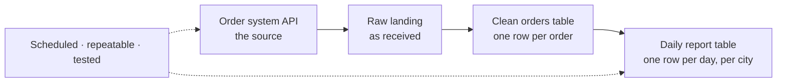
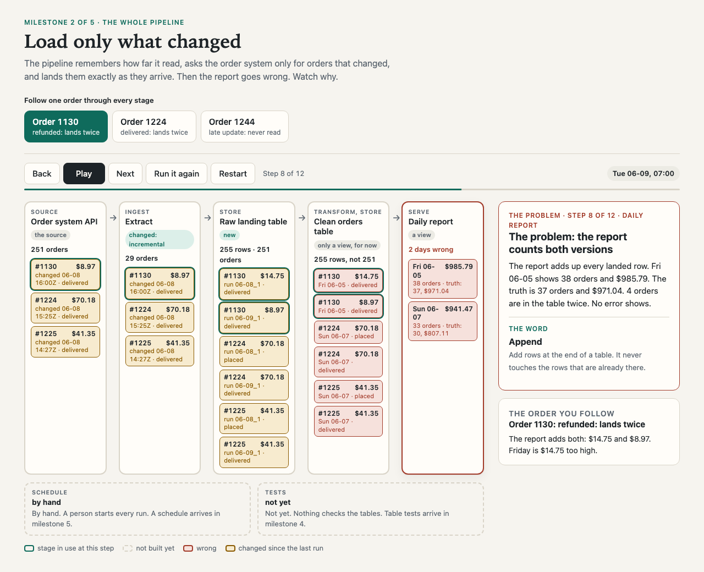
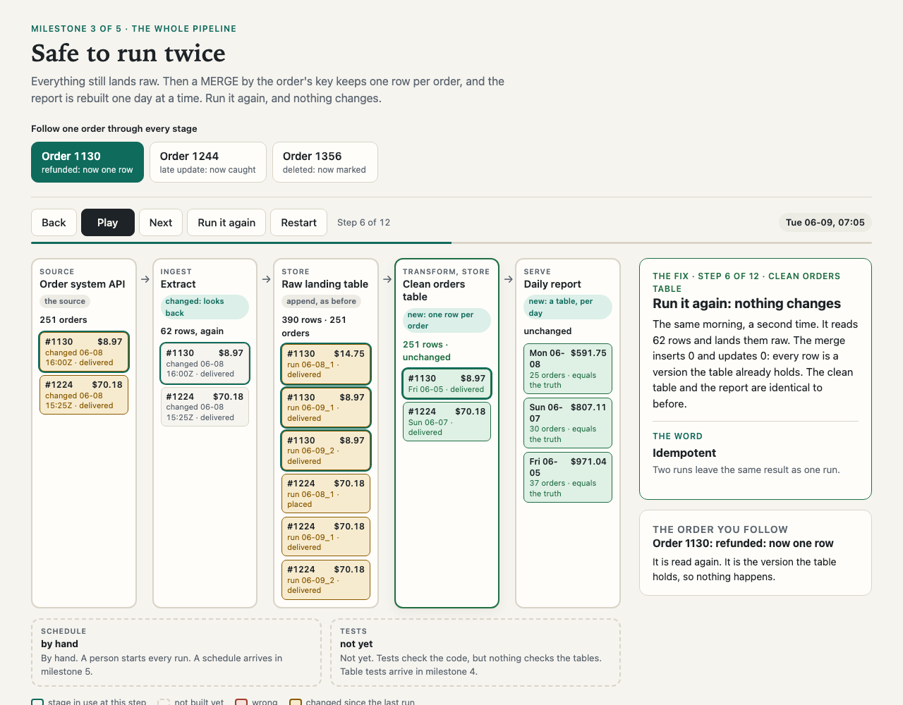
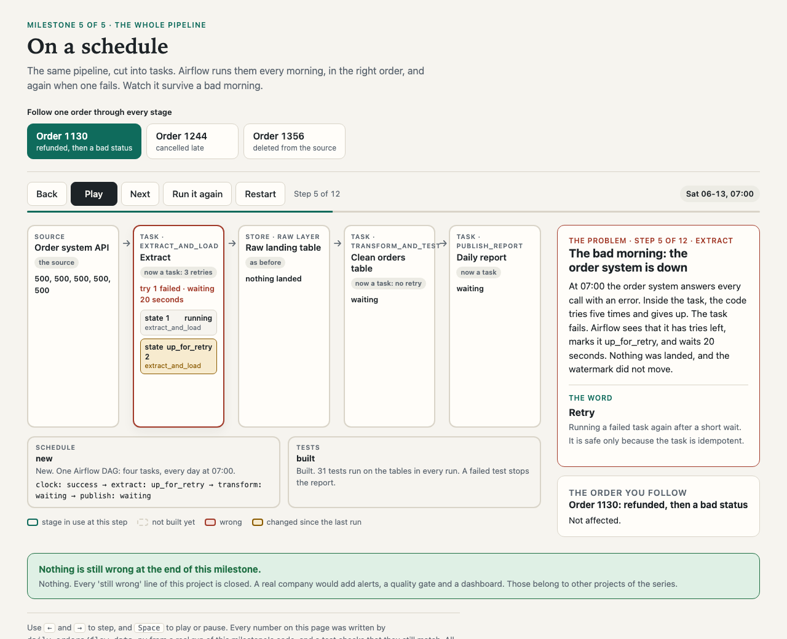

# Daily Orders: API to Warehouse

**A hands-on data engineering project for beginners.** Build the most common job in data engineering: move data from a source system to a warehouse every day, and get a number the business can trust.

> How many orders did we take yesterday, how much money did they bring in, how does that compare with the day before, and has any earlier day changed since I last looked?

An operations manager asks that question every morning at 08:00. You build the pipeline that answers it: load new and changed orders every day, safe to run twice, with tests on the final table.


*The live page. You pick a morning and press Run. The real pipeline runs on your computer, and its report is held up against an answer key.*

| | |
|---|---|
| **Who it is for** | You know some Python and a little SQL. You have never built a pipeline, never used Airflow, never used dbt |
| **What you need** | Git, Python 3.12 or later, [uv](https://docs.astral.sh/uv/), and Docker from milestone 2 on |
| **What it costs** | Nothing. No API key, no cloud account, no AI. Everything runs on your computer |
| **Status** | All five milestones are complete |

It is the second project of the [D8Loop Data Engineering Projects](https://www.d8loop.com/modules/knowledge-corner/data-engineering-projects#batch-pipelines) series, in the **Batch pipelines** category. The first is [Retail Profit Stack](https://github.com/vijaysngrajput/retail-profit-stack).

## Try it in two minutes

You need Git, uv and Docker.

```sh
git clone https://github.com/vijaysngrajput/daily-orders-api-to-warehouse.git
cd daily-orders-api-to-warehouse
uv sync                          # makes the virtual environment and installs everything
docker compose up -d warehouse   # starts the warehouse: Postgres
uv run python -m order_system    # starts the fake order system; leave it running
```

In a second terminal, run the pipeline for one morning:

```sh
uv run python -m order_system.clock --morning 2026-06-08
cd src/m5_on_a_schedule
uv run python -m daily_orders
```

You get the manager's report:

```
extract-load: run 2026-06-08_1 landed 226 rows in 10 API calls.
transform-test: dbt built 7 models and passed 31 tests on the tables.

Arden daily orders. Report for the morning of Mon 2026-06-08

  Yesterday   Sun 2026-06-07    30 orders      $807.11
  Day before  Sat 2026-06-06    33 orders      $786.71
  Change                         -3 orders      +$20.40
```

Now move the clock one day and run it again:

```sh
uv run python -m order_system.clock --advance-days 1
uv run python -m daily_orders
```

An earlier day has changed, and the report says why:

```
  Earlier days that changed in this run:
    Fri 2026-06-05   +0 orders   -$5.78
      because order 1130: refund of $5.78
```

That is the heart of the project. **Yesterday's orders are not the same today as they were yesterday.** A pipeline that only loads "new" orders gives a wrong number.

**No Docker yet?** Milestone 1 needs none. Follow [its README](src/m1_report_by_hand/).

## Or watch it, and break it

```sh
uv run python pipeline_live/server.py
```

The [live page](pipeline_live/) opens in your browser. Pick a morning, press **Run**, and watch the rows move from the API to the report. Then run the same morning again, take the API down, send a page twice, or send a bad row.

## The business

**Arden** is a fictional online grocery market. Customers order in an app, and Arden delivers the same day in three cities. An order is not finished when it is placed: its status moves, it can be cancelled, an item can be out of stock, a refund can arrive days later, and a test order can be deleted.

Open [the business page](https://vijaysngrajput.github.io/daily-orders-api-to-warehouse/understand_business/arden_orders.html) to watch one order live, from five points of view.


## What you build



| Part | Built with |
|---|---|
| A small fake order API, with a clock you control and faults you can switch on | FastAPI |
| Extract and load: only what changed, with retries | Python |
| The warehouse | Postgres, in Docker |
| Transform: staging, a clean `orders` and `order_items`, the `daily_orders` report | dbt |
| Tests on the tables, and tests on the code | dbt tests, pytest |
| A schedule: one DAG that runs daily and can re-run any past day | Apache Airflow |

## Milestones

Build forward, one pain at a time. Each milestone ends with something that is **still wrong**. That is the reason the next one exists.

| Milestone | What you build | Still wrong at the end | Notebooks |
|---|---|---|---|
| [1. The report, by hand](src/m1_report_by_hand/) | Read every order, load one table, answer the question with one SQL query | It reloads every order every day, and hits the API's rate limit | 7 |
| [2. Load only what changed](src/m2_load_only_what_changed/) | A watermark, retries, and a raw landing table in Postgres | A changed order is in the table twice, and the report counts it twice | 8 |
| [3. Safe to run twice](src/m3_safe_to_run_twice/) | `MERGE` on the order's key, proved with tests. A lookback for late rows. Soft deletes | All the logic is in one script, and nothing checks the tables | 8 |
| [4. Models and tests](src/m4_models_and_tests/) | dbt models in three layers, an incremental report, table tests and a freshness check | A person must remember to run it | 7 |
| [5. On a schedule](src/m5_on_a_schedule/) | One Airflow DAG: retries, backfills, and a "bad morning" drill | Nothing | 7 |

You practise the five things a batch pipeline is made of: **ingestion, incremental loads, idempotent reruns, scheduling and table tests**.

|  |  |
|---|---|
| *Milestone 2. A refunded order lands twice, and the report counts both.* | *Milestone 3. The same run again: 0 inserted, 0 updated.* |
|  |  |
| *Milestone 4. A table test fails, and the report is not rebuilt.* | *Milestone 5. The API is down. Airflow waits, and tries again.* |

## Start here

1. **Understand the business.** Open [the business page](https://vijaysngrajput.github.io/daily-orders-api-to-warehouse/understand_business/arden_orders.html).
2. **Try it in two minutes** (above), or play with the live page.
3. **Work through the milestones in order**, starting with [milestone 1](src/m1_report_by_hand/). Each README gives the reading order.

The pages ending in `.html` are animated. GitHub shows only their source, so view them online here, or open them from your own copy of the project.

| Page | What it shows |
|---|---|
| [How one Arden order lives](https://vijaysngrajput.github.io/daily-orders-api-to-warehouse/understand_business/arden_orders.html) | One order from placed to delivered, and how it changes later |
| Flow pages: [1](https://vijaysngrajput.github.io/daily-orders-api-to-warehouse/src/m1_report_by_hand/milestone_1_flow.html) · [2](https://vijaysngrajput.github.io/daily-orders-api-to-warehouse/src/m2_load_only_what_changed/milestone_2_flow.html) · [3](https://vijaysngrajput.github.io/daily-orders-api-to-warehouse/src/m3_safe_to_run_twice/milestone_3_flow.html) · [4](https://vijaysngrajput.github.io/daily-orders-api-to-warehouse/src/m4_models_and_tests/milestone_4_flow.html) · [5](https://vijaysngrajput.github.io/daily-orders-api-to-warehouse/src/m5_on_a_schedule/milestone_5_flow.html) | The whole pipeline at each milestone, with real orders moving through it. The same layout five times, so you see what changed |
| Recap pages: [1](https://vijaysngrajput.github.io/daily-orders-api-to-warehouse/src/m1_report_by_hand/milestone_1_recap.html) · [2](https://vijaysngrajput.github.io/daily-orders-api-to-warehouse/src/m2_load_only_what_changed/milestone_2_recap.html) · [3](https://vijaysngrajput.github.io/daily-orders-api-to-warehouse/src/m3_safe_to_run_twice/milestone_3_recap.html) · [4](https://vijaysngrajput.github.io/daily-orders-api-to-warehouse/src/m4_models_and_tests/milestone_4_recap.html) · [5](https://vijaysngrajput.github.io/daily-orders-api-to-warehouse/src/m5_on_a_schedule/milestone_5_recap.html) | What was asked, what you built, what you learned, what is still wrong |
| [The live page](pipeline_live/) | The finished pipeline, run by you. It needs a small local server, so it is not online |

No number on a flow page or a recap page is typed by hand. A script runs the milestone's real code and writes what happened into the page, and a test fails when a page is out of date.

## The words you learn

The project teaches the working words of data engineering: 73 of them, one or two at a time. You meet the problem in your own data first, and the word second. You see each word on Arden's own rows, compared with its opposite.

Every word is in [GLOSSARY.md](GLOSSARY.md), with a line you can say in an interview. The theory behind each one is in the [D8Loop Data Pipeline knowledge base](https://www.d8loop.com/modules/knowledge-corner/data-pipeline), in its Foundations and Building & Orchestration chapters.

## How every milestone is built

The same standard as Retail Profit Stack, so if you know one project you know both.

Each milestone is a **self-contained folder** under `src/`. It imports nothing from another milestone. Code is copied forward on purpose, so you can compare two folders.

```
src/<milestone>/
  README.md               reading order, and how to run it
  docs/                   BRD.md, HLD.md, LLD.md, each with diagrams
  notebooks/              the lab: numbered notebooks, run in order
  daily_orders/           production code
  tests/                  tests for the production code
  milestone_N_flow.html   the whole pipeline at this milestone, animated
  milestone_N_recap.html  an animated closing page
```

Shared by every milestone:

| Folder | Holds |
|---|---|
| [order_system/](order_system/) | The fake order API. It is the outside world, not part of any pipeline |
| [understand_business/](understand_business/) | The business page |
| [pipeline_live/](pipeline_live/) | The live page |
| `docker-compose.yml`, `docker/` | The warehouse, and Airflow for milestone 5 |

Each milestone is built in the same order: design documents, lab notebooks, production code and tests, flow page, recap page. In the lab you do each new idea by hand once, and you check every result against an answer key.

## Set up

Install Git, Python 3.12 or later, and [uv](https://docs.astral.sh/uv/). From milestone 2 on, also Docker.

| System | Install uv |
|---|---|
| macOS, Linux | `curl -LsSf https://astral.sh/uv/install.sh \| sh` |
| Windows (PowerShell) | `powershell -ExecutionPolicy ByPass -c "irm https://astral.sh/uv/install.ps1 \| iex"` |

Then, in the project folder:

```sh
uv sync
```

This makes a virtual environment in `.venv` and installs everything into it, dbt included. Nothing is installed outside the project. Start every command with `uv run`, and it runs inside that environment.

| Milestone | Needs running |
|---|---|
| 1 | The order system: `uv run python -m order_system` |
| 2, 3, 4 | The order system, and the warehouse: `docker compose up -d warehouse` |
| 5 | Everything in Docker: `docker compose --profile schedule up -d --build` |

In VS Code, install the Python and Jupyter extensions. Open a notebook, choose **Select Kernel**, then **Python Environments**, and pick this project's `.venv`.

| Port | Used by |
|---|---|
| 8010 | The order system |
| 5440 | The warehouse |
| 8080 | Airflow's page, in milestone 5 |
| 8030 | The live page |

## Shut everything down

Nothing in this project stops by itself. When you are done, stop what you started.

| You started | It keeps running | Stop it with |
|---|---|---|
| `uv run python -m order_system` | The order system, on port 8010 | **Ctrl+C** in that terminal |
| `uv run python pipeline_live/server.py` | The live page, on port 8030 | **Ctrl+C** in that terminal |
| A notebook | A Python kernel | Close the notebook, or **Shut Down Kernel** in VS Code |
| `docker compose up -d warehouse` | The warehouse container, on port 5440 | `docker compose down` |
| `docker compose --profile schedule up -d --build` | Three containers: the warehouse, the order system (8010) and Airflow (8080) | `docker compose --profile schedule down` |

Run the `docker compose` commands from the project folder. To check that nothing is left: `docker compose --profile schedule ps` should list no containers.

`down` stops and removes the containers, and **keeps your data**. The next `up` finds the warehouse as you left it. To remove more:

| To remove | Command | What you lose |
|---|---|---|
| The warehouse data | `docker compose --profile schedule down -v` | Every table in every milestone's database. The next run starts empty |
| The Airflow image, about 3 GB | `docker rmi arden-airflow:3.4.0 apache/airflow:3.4.0` | Nothing but disk space. The next start downloads it again |
| The Postgres image | `docker rmi postgres:16` | The same |
| The virtual environment | Delete the `.venv` folder | Nothing. `uv sync` makes it again |

To pause without removing anything, use `stop` and `start` in place of `down` and `up`: `docker compose --profile schedule stop`.

## Run the tests

```sh
cd order_system && uv run pytest                    # the fake order system
cd src/m1_report_by_hand && uv run pytest           # milestone 1: nothing needs to be running
cd src/m2_load_only_what_changed && uv run pytest   # milestones 2 to 4 need the warehouse
cd src/m3_safe_to_run_twice && uv run pytest
cd src/m4_models_and_tests && uv run pytest         # over a minute: it runs dbt many times
cd src/m5_on_a_schedule && uv run pytest            # about seven minutes: it drives the real Airflow
uv run pytest pipeline_live                         # the live page; needs the warehouse
```

The tests start their own private order system, and use their own databases.

## Built with

Python, [uv](https://docs.astral.sh/uv/), FastAPI, pandas, DuckDB, Postgres 16, Docker Compose, dbt 1.12 with dbt-postgres 1.11, Apache Airflow 3.4, and pytest.

## What this project is not

| Not here | Where it belongs in the series |
|---|---|
| A streaming pipeline. Streaming is explained, not built | The clickstream project |
| A lake, or table formats | The lakehouse project |
| A full star schema, or a dashboard | The warehouse project |
| Deep quality gates, alerts, incident practice | The quality project |
| AI | Retail Profit Stack |

## About the data

Everything here is fictional: Arden, its cities, its customers, its products and its prices. The orders are generated from a fixed seed, so everyone gets the same numbers. The project does not describe any real company's systems or data.

## Licence

[MIT](LICENSE). Use it, change it, and teach with it.
