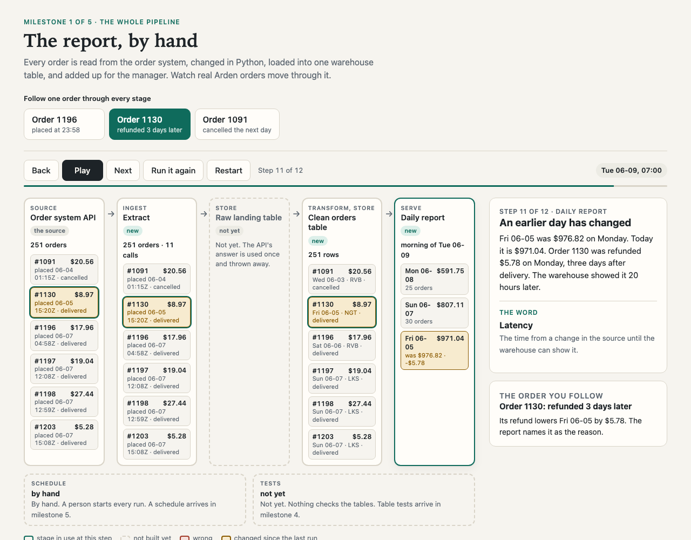
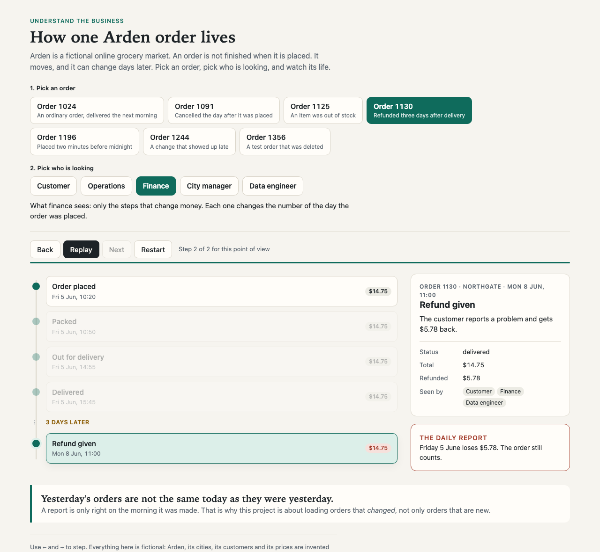
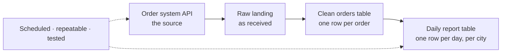

# Daily Orders: API to Warehouse

**A hands-on data engineering project for beginners.** Build the most common job in data engineering: move data from a source system to a warehouse every day, and get a number the business can trust.

> How many orders did we take yesterday, how much money did they bring in, how does that compare with the day before, and has any earlier day changed since I last looked?

An operations manager asks that question every morning at 08:00. You build the pipeline that answers it.



*The flow page of milestone 1. Real orders move through every stage. Here an order refunded three days after delivery lowers an earlier day's number.*

| | |
|---|---|
| **Who it is for** | You know some Python and a little SQL. You have never built a pipeline |
| **What you need** | Git, Python 3.12 or later, and [uv](https://docs.astral.sh/uv/). Docker from milestone 2 |
| **What it costs** | Nothing. No API key, no cloud account, no AI. Everything runs on your computer |
| **Status** | Milestone 1 of 5 is complete. Milestones 2 to 5 are being built |

It is the second project of the [D8Loop Data Engineering Projects](https://www.d8loop.com/modules/knowledge-corner/data-engineering-projects#batch-pipelines) series. The first is [Retail Profit Stack](https://github.com/vijaysngrajput/retail-profit-stack).

## Try it in two minutes

```sh
git clone https://github.com/vijaysngrajput/daily-orders-api-to-warehouse.git
cd daily-orders-api-to-warehouse
uv sync                          # makes the virtual environment and installs everything
uv run python -m order_system    # starts the fake order system; leave it running
```

In a second terminal:

```sh
uv run python -m order_system.clock --morning 2026-06-08
cd src/m1_report_by_hand
uv run python -m daily_orders
```

You get the manager's report:

```
Loaded 226 orders in 10 API calls.

Arden daily orders. Report for the morning of Mon 2026-06-08

  Yesterday   Sun 2026-06-07    30 orders      $807.11
  Day before  Sat 2026-06-06    33 orders      $786.71
  Change                         -3 orders      +$20.40
```

Now move the clock one day and run it again:

```sh
uv run python -m order_system.clock --advance-days 1
uv run python -m daily_orders
```

An earlier day has changed, and the report says why:

```
  Earlier days that changed since the report of Mon 2026-06-08:
    Fri 2026-06-05   +0 orders   -$5.78
      because order 1130: refund of $5.78
```

That is the heart of the project. **Yesterday's orders are not the same today as they were yesterday.**

## The business

**Arden** is a fictional online grocery market. Customers order in an app, and Arden delivers the same day in three cities. An order is not finished when it is placed: its status moves, it can be cancelled, an item can be out of stock, a refund can arrive days later.

Open [understand_business/arden_orders.html](understand_business/arden_orders.html) to watch one order live, from five points of view.



## What you build



## Milestones

Each milestone ends with something that is **still wrong**. That is the reason the next one exists.

| Milestone | What you build | Still wrong at the end | Status |
|---|---|---|---|
| [1. The report, by hand](src/m1_report_by_hand/) | Read every order, load one table, answer the question with one SQL query | It reloads every order every day, and hits the API's rate limit | ✅ Done: 7 notebooks |
| 2. Load only what changed | A watermark, and a raw landing table | A changed order is in the table twice | Planned |
| 3. Safe to run twice | `MERGE`, proved with tests. A lookback for late rows | All the logic is in one script, and nothing checks the tables | Planned |
| 4. Models and tests | dbt models and table tests | A person must remember to run it | Planned |
| 5. On a schedule | One Airflow DAG, with retries and backfills | Nothing | Planned |

By the end you practise the five things a batch pipeline is made of: **ingestion, incremental loads, idempotent reruns, scheduling and table tests**.

## Start here

1. **Understand the business.** Open [understand_business/arden_orders.html](understand_business/arden_orders.html) in a browser.
2. **Try it in two minutes** (above).
3. **Work through [milestone 1](src/m1_report_by_hand/).** Its README gives the reading order.

The pages ending in `.html` are animated. GitHub shows only their source, so view them online here, or open them from your own copy of the project.

| Page | What it shows |
|---|---|
| [How one Arden order lives](https://vijaysngrajput.github.io/daily-orders-api-to-warehouse/understand_business/arden_orders.html) | One order from placed to delivered, and how it changes later |
| [Milestone 1 flow](https://vijaysngrajput.github.io/daily-orders-api-to-warehouse/src/m1_report_by_hand/milestone_1_flow.html) | The whole pipeline at milestone 1, with real rows moving through it |
| [Milestone 1 recap](https://vijaysngrajput.github.io/daily-orders-api-to-warehouse/src/m1_report_by_hand/milestone_1_recap.html) | What was asked, what you built, what you learned, what is still wrong |

## The words you learn

The project teaches the working words of data engineering, one or two at a time. You meet the problem in your own data first, and the word second. Every word is in [GLOSSARY.md](GLOSSARY.md) with a line you can say in an interview. The theory behind each one is in the [D8Loop Data Pipeline knowledge base](https://www.d8loop.com/modules/knowledge-corner/data-pipeline).

## How every milestone is built

The same standard as Retail Profit Stack, so if you know one project you know both.

Each milestone is a **self-contained folder** under `src/`. It imports nothing from another milestone. Code is copied forward on purpose, so you can compare two folders.

```
src/<milestone>/
  README.md               reading order, and how to run it
  docs/                   BRD.md, HLD.md, LLD.md, each with diagrams
  notebooks/              the lab: numbered notebooks, run in order
  daily_orders/           production code
  tests/                  tests for the production code
  milestone_N_flow.html   the whole pipeline at this milestone, animated
  milestone_N_recap.html  an animated closing page
```

Two folders are shared by every milestone:

| Folder | Holds |
|---|---|
| [order_system/](order_system/) | The fake order API. It is the outside world, not part of any pipeline |
| [understand_business/](understand_business/) | The business page |

Each milestone is built in the same order: design documents, lab notebooks, production code and tests, flow page, recap page. In the lab you do each new idea by hand once, and you check every result against an answer key.

## Set up

Install Git, Python 3.12 or later, and [uv](https://docs.astral.sh/uv/).

| System | Install uv |
|---|---|
| macOS, Linux | `curl -LsSf https://astral.sh/uv/install.sh \| sh` |
| Windows (PowerShell) | `powershell -ExecutionPolicy ByPass -c "irm https://astral.sh/uv/install.ps1 \| iex"` |

Then, in the project folder:

```sh
uv sync
```

This makes a virtual environment in `.venv` and installs everything into it. Nothing is installed outside the project. Start every command with `uv run`, and it runs inside that environment.

In VS Code, install the Python and Jupyter extensions. Open a notebook, choose **Select Kernel**, then **Python Environments**, and pick this project's `.venv`.

The order system listens on port 8010. If that port is taken, see [order_system/README.md](order_system/README.md).

## Run the tests

```sh
cd order_system && uv run pytest            # the fake order system
cd src/m1_report_by_hand && uv run pytest   # milestone 1
```

The tests start their own private order system. Nothing needs to be running.

## Built with

Python, [uv](https://docs.astral.sh/uv/), FastAPI, pandas, DuckDB and pytest. Postgres, Docker Compose, dbt and Apache Airflow arrive in later milestones.

## About the data

Everything here is fictional: Arden, its cities, its customers, its products and its prices. The orders are generated from a fixed seed, so everyone gets the same numbers. The project does not describe any real company's systems or data.

## Licence

[MIT](LICENSE). Use it, change it, and teach with it.
