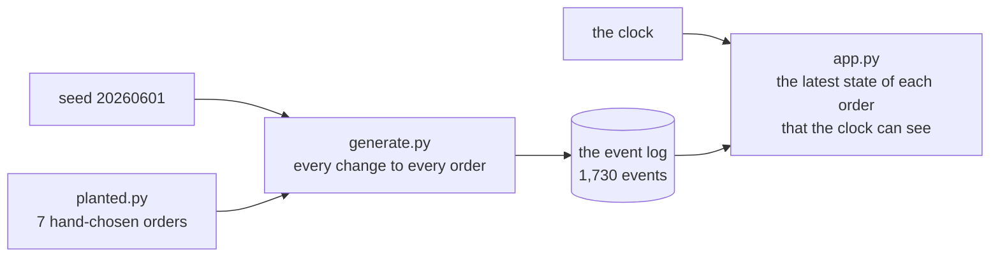

# The order system

This folder is **the source**: Arden's order system. It is a small fake, written for this project. It is the outside world. No pipeline code lives here, and every milestone uses the same one.

## Start it

From the project folder:

```sh
uv run python -m order_system
```

Leave it running. Open http://127.0.0.1:8010/docs to try it in a browser.

In milestone 5 it runs in Docker instead, on the same port: `docker compose --profile schedule up -d --build`. Stop the one in your terminal first.

It listens on port 8010. To use another port, set it in both terminals:

| System | Start the order system | Tell the other programs |
|---|---|---|
| macOS, Linux | `ARDEN_API_PORT=8020 uv run python -m order_system` | `export ARDEN_API_URL=http://127.0.0.1:8020` |
| Windows (PowerShell) | `$env:ARDEN_API_PORT=8020; uv run python -m order_system` | `$env:ARDEN_API_URL="http://127.0.0.1:8020"` |

## Stop it

Press **Ctrl+C** in its terminal. It keeps nothing: the next start is back at the first morning, 2 June 2026.

In milestone 5, when it runs in Docker: `docker compose --profile schedule down`, from the project folder.

## What it serves

| Call | Returns |
|---|---|
| `GET /orders?updated_since=&cursor=` | Up to 25 orders, sorted by `updated_at`, and a `next_cursor` |
| `GET /orders/{order_id}` | One order. 404 when it was deleted |
| `GET /admin/clock` | The time on the order system's clock |
| `POST /admin/clock` | Moves the clock |
| `POST /admin/reset` | Back to the first morning, with no faults |
| `POST /admin/faults` | Makes the next calls to `GET /orders` go wrong (see below) |
| `GET /changes?after_pos=` | Lab only: the change feed. Every insert, update and delete, in order |
| `POST /webhooks`, `DELETE /webhooks` | Lab only: register or remove an address that receives each change |

It allows 12 calls to `GET /orders` in 10 seconds. The next call is refused with status 429 and a `Retry-After` header.

### Faults you can switch on

| Body of `POST /admin/faults` | What the next calls do |
|---|---|
| `{"kind": "error_500", "count": 2}` | Two calls answer 500 |
| `{"kind": "rate_limit", "count": 1}` | One call answers 429 with `Retry-After: 1` |
| `{"kind": "repeat_page", "count": 1}` | One page is served twice |

## The clock is yours

The order system has its own clock, and it only moves when you move it. So you can go to "the next morning" at once.

```sh
uv run python -m order_system.clock                        # show the time
uv run python -m order_system.clock --morning 2026-06-08   # 07:00 on that day
uv run python -m order_system.clock --advance-days 1       # the next day
uv run python -m order_system.clock --advance-minutes 5    # five minutes later
uv run python -m order_system.clock --reset                # back to 2026-06-02
```

## The data



- 14 business days: Monday 2026-06-01 to Sunday 2026-06-14. 432 orders in three cities.
- Arden's time zone is `America/Chicago`. The API writes every time in UTC.
- Ordinary orders move to `delivered`, and their money never changes.
- **Seven planted orders** do something a pipeline must handle. Their items are chosen by hand, so each total can be checked with a pencil.

| Order | Case | What happens |
|---|---|---|
| 1024 | Status changes on a later day | Placed Mon 06-01 21:40, delivered Tue 09:15 |
| 1091 | Cancelled the next day | Placed Wed 06-03, cancelled Thu 08:30 |
| 1125 | An item is out of stock | Total drops from $36.94 to $32.35 on Fri 06-05 |
| 1130 | Refund three days after delivery | Delivered Fri 06-05, $5.78 refunded Mon 06-08 |
| 1196 | Placed just before midnight | Sat 06-06 23:58:12 in Arden. Sunday in UTC |
| 1244 | An update that arrives late | Cancelled Mon 06-08 21:35, shown by the API Tue 10:15 |
| 1356 | Deleted from the source | A test order. Placed Fri 06-12, deleted Sat 11:00 |

One more case is a fault, not an order. In every run of 2026-06-11 the second page is served twice.

The design is in [docs/source_data_proposal.md](../docs/source_data_proposal.md).

## Files

| File | Holds |
|---|---|
| `catalog.py` | The time zone, the cities and the products |
| `planted.py` | The planted orders |
| `generate.py` | Builds the event log from the seed |
| `app.py` | The API |
| `truth.py` | The answer key, worked out from the event log with no pipeline code |
| `clock.py` | Moves the clock from the command line |
| `business_page.py` | Writes the data of the business page |
| `tests/` | Tests for all of it: `uv run pytest` in this folder |
