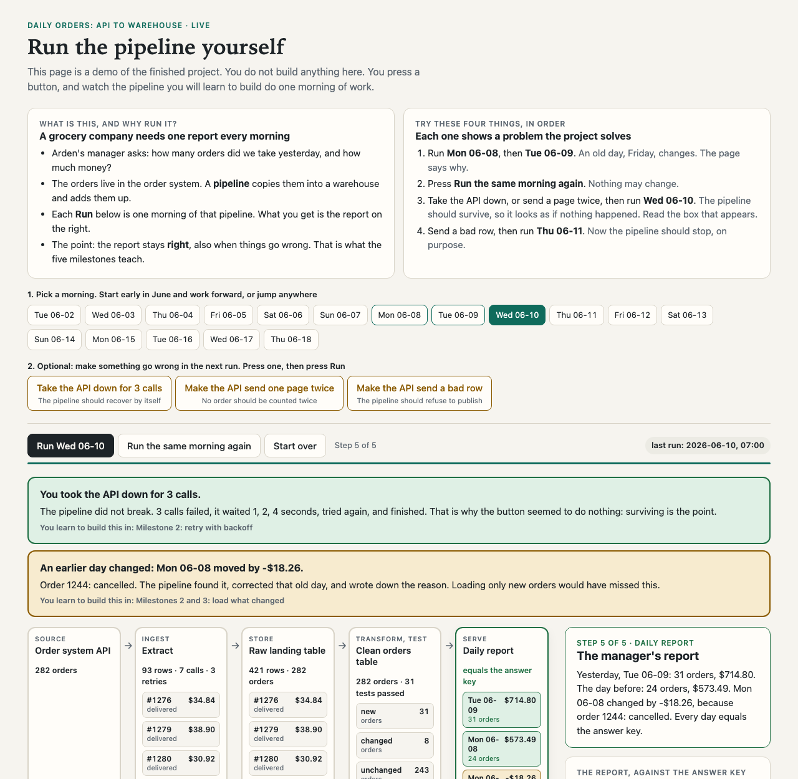

# The live pipeline

One page where you run the finished pipeline yourself, on a day you choose.



## Start it

The warehouse must be running. From the project folder:

```sh
docker compose up -d warehouse
uv run python pipeline_live/server.py
```

Your browser opens http://127.0.0.1:8030 . Stop the server with Ctrl+C. To use another port, set `ARDEN_LIVE_PORT`.

You do **not** need to start the order system or Airflow. The order system runs inside this program.

## Shut it down

| You started | Stop it with |
|---|---|
| The live page, `uv run python pipeline_live/server.py` | **Ctrl+C** in its terminal |
| The warehouse, `docker compose up -d warehouse` | `docker compose down`, from the project folder |

The page keeps its data in the database `arden_live`. Every start of the server empties it.

## What to try

1. **Run a morning.** Pick Monday 8 June and press **Run**. Rows move from the API to the report, and the report is held up against the answer key.
2. **Run the next morning.** Pick Tuesday 9 June. The run reads only what changed, and Friday's number moves, with the reason.
3. **Run the same morning again.** Nothing changes: 0 new orders, 0 changed.
4. **Break the API.** Press *The API is down for 3 calls*, then run a morning. The load waits, tries again and finishes.
5. **Send a page twice.** More rows land than there are orders. The report is still right.
6. **Send a bad status.** A table test fails, and the report keeps its last good numbers. Press **Fix the source and run again**.
7. **Jump.** Skip a few mornings, or go back to an earlier one. The report still equals the answer key.

## What is real, and what is not

| Real | Special to this page |
|---|---|
| The pipeline code: `src/m5_on_a_schedule/daily_orders/` | The order system runs inside the server, not as its own program |
| The dbt models and the 31 table tests | Waiting is skipped: the page says how long the pipeline wanted to wait |
| Postgres, in its own database `arden_live` | A person presses Run. In milestone 5 an Airflow DAG does |
| The answer key, from the order system's event log | |

## Files

| File | Holds |
|---|---|
| `server.py` | A small web server: it runs the pipeline and describes each stage |
| `index.html` | The page. One file, no build step |
| `test_live.py` | Tests: `uv run pytest pipeline_live` |
