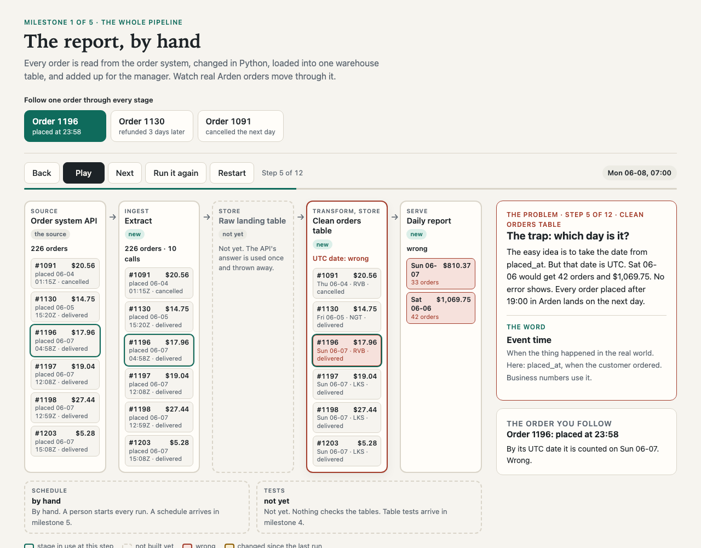

# Milestone 1: The report, by hand

**Status:** Done. Design documents, lab notebooks, production code, tests, flow page and recap page are complete.

This folder is self-contained. Nothing in it imports from another milestone.



## Why this milestone exists

A person answers the manager's morning question by hand, from an exported file. They are sometimes late and sometimes wrong. A program should do it, with the same steps every day.

**What you build:** a first pipeline. It reads every order from the order system, changes them in pandas, loads one warehouse table, and answers the question with one SQL query.

**The outcome:** for the morning of Monday 2026-06-08 the report says Sunday 30 orders and $807.11, Saturday 33 orders and $786.71. That equals an answer you work out by hand. The next morning it shows that Friday went down by $5.78, and names the order.

## The numbers

| Notebooks | Tests | Warehouse tables | Orders loaded on 06-08 | API calls | New words |
|---|---|---|---|---|---|
| 7 | 34 | 3 | 226 | 10 | 14 |

## Read it in this order

1. **[milestone_1_flow.html](milestone_1_flow.html)**: open it in a browser first, to see where you are going.
2. [docs/BRD.md](docs/BRD.md): what the business needs and why.
3. [docs/HLD.md](docs/HLD.md): the parts, and how data moves between them.
4. [docs/LLD.md](docs/LLD.md): the exact tables, SQL and functions. Keep it open for the next two steps.
5. The notebooks in `notebooks/`, from `01` to `07`.
6. The code in `daily_orders/` and `tests/`: the same logic, rebuilt as a program.
7. **[milestone_1_flow.html](milestone_1_flow.html)** again, to check what you built.
8. [milestone_1_recap.html](milestone_1_recap.html): a look back.

## What is in this folder

| Folder | Holds |
|---|---|
| [docs/](docs/) | [BRD](docs/BRD.md), [HLD](docs/HLD.md) and [LLD](docs/LLD.md), each with diagrams |
| `notebooks/` | The lab: seven notebooks, run in order, plus `lab_helpers.py` |
| `daily_orders/` | Production code |
| `tests/` | Tests for the production code |
| [milestone_1_flow.html](milestone_1_flow.html) | The whole pipeline at this milestone, animated, with real orders |
| [milestone_1_recap.html](milestone_1_recap.html) | The closing page |

## Set up

This milestone needs Git, Python 3.12 or later, and [uv](https://docs.astral.sh/uv/). **No Docker.** The commands are the same on macOS, Linux and Windows.

From the project folder, once:

```sh
uv sync
```

Then start the order system and leave it running:

```sh
uv run python -m order_system
```

## The lab

Open the notebooks in VS Code, choose the project's `.venv` as the kernel, and run them in order. The order system must be running.

| Notebook | What you do | New words |
|---|---|---|
| `01_the_question_and_the_source` | Read the question. Meet the order system. Look at one order | Data pipeline, source, destination |
| `02_read_every_order` | Follow the pages of the API to the end | Full load |
| `03_the_answer_by_hand` | Work out the answer with plain Python. Meet the time zone trap | Event time, grain |
| `04_transform_then_load` | Put the orders in a warehouse table. Ask it one SQL question | ETL, the five stages |
| `05_every_morning` | Run it again the next day. Watch an old number change | Load time |
| `06_why_batch_and_where_it_breaks` | Measure how late the report is. Then watch the load fail | Latency, batch, freshness |
| `07_the_production_version` | The same logic as a tested program | |

Notebook 3 saves `notebooks/results/answer_key.json`. Later notebooks and one test read it, so run the notebooks in order the first time.

## Run the program

In a second terminal, from this folder:

```sh
uv run python -m order_system.clock --morning 2026-06-08
uv run python -m daily_orders
```

Move to the next morning and run again:

```sh
uv run python -m order_system.clock --advance-days 1
uv run python -m daily_orders
```

## Run the tests

```sh
uv run pytest
```

The tests start their own private order system, so nothing needs to be running.

## The pages show real numbers

No number on the flow page or the recap page is typed by hand. A script runs the real pipeline and writes what happened into the pages. A test fails when a page is out of date.

```sh
uv run python -m daily_orders.flow_data
```

## Five things you learn

1. A pipeline is the whole chain, run again and again. One query is not a pipeline.
2. Say which day, on which clock. Business numbers use event time, in the business time zone.
3. Say what one row means before you add anything up. That is the grain.
4. Yesterday's orders are not the same today as they were yesterday.
5. Work the answer out by hand first. Without an answer key, you cannot tell a right number from a wrong one.

## New words

| Word | Meaning |
|---|---|
| **Data pipeline** | It moves data from where it is made to where it is used. It works in steps, and it runs on a schedule |
| **Source**, **destination** | Where the data is made, and where it is used |
| **Full load** | It reads every row on every run |
| **Event time** | When the thing happened in the real world. Business numbers use it |
| **Grain** | What one row of a table means |
| **ETL** | Extract, transform, load. It transforms the data and then loads only the result |
| **The five stages** | Ingest, store, transform, serve, observe |
| **Load time** | When the pipeline copied the row |
| **Latency** | The time from a change in the source until the warehouse can show it |
| **Batch** | One run handles a whole slice of data, then stops |
| **Freshness** | How new the data in the warehouse is |
| **Micro-batch**, **streaming** | Batch with a very small slice, run again and again. And a job that never stops |

Each word has an interview line in the project's [GLOSSARY.md](../../GLOSSARY.md).

## Still wrong

> It reloads every order every day. It is slow, and it hits the API's rate limit.

On the morning of 2026-06-11 the load needs 13 API calls. The API allows 12. Milestone 2 loads only what changed.
