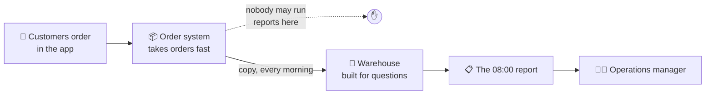
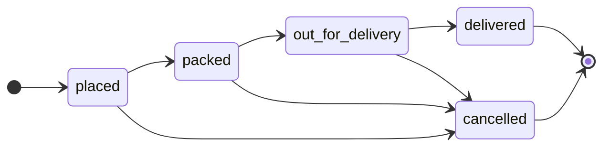

# BRD: Milestone 1, The report, by hand

**Status:** Final; built
**Milestone:** 1 of 5 (see the project [README](../../../README.md#milestones))

> **What this document is.** A business requirements document (BRD) says what the business needs and why. It uses business words and no technology. Read it first. Next, read the [HLD](HLD.md) to see what gets built.

## 1. The business problem

Arden is a fictional online grocery market. Customers order in an app. Arden delivers the same day in three cities.

Every morning the operations manager needs yesterday's numbers. Today a person makes the report by hand, from a file exported from the admin page. That person is sometimes ill, sometimes late, and sometimes wrong.

Arden wants the same report made by a program, with the same steps every day.

**Why copy the data at all?** The order system has one job: take orders fast. A heavy report slows the app down for customers. So nobody may run reports on it. The data is copied out to a second place, the warehouse.

## 2. The people

| Person | What they need |
|---|---|
| 👩‍💼 Operations manager | Yesterday's orders and money, at 08:00, to plan drivers and stock |
| 💰 Finance | The money each day brought in, and a reason for every later change |
| 🏙️ City managers | Their city beside the other two |
| 🎓 Learner | A first working pipeline that every later milestone improves |

## 3. The question to answer

> How many orders did we take yesterday, how much money did they bring in, how does that compare with the day before, and has any earlier day changed since I last looked?

It is four questions in one:

| # | Part | Example of an answer |
|---|---|---|
| 1 | How many orders yesterday? | 30 orders |
| 2 | How much money? | $807.11 |
| 3 | Against the day before? | 3 fewer orders, $20.40 more |
| 4 | Did an earlier day change? | Friday went down by $5.78, because of one refund |

## 4. An order keeps changing

An order is not finished when it is placed.

Three more things can happen, sometimes days later:

| Change | Effect on the report |
|---|---|
| An item is out of stock | The order's total goes down |
| A refund is given | The day's money goes down |
| A test order is deleted | The order should never have been counted |

So **yesterday's orders are not the same today as they were yesterday.** A report is only right on the morning it was made.

## 5. Business rules

| Rule | Decision |
|---|---|
| Business day | The date the order was **placed**, on the clock in Arden's cities (`America/Chicago`) |
| Which orders count | Every order that is not cancelled |
| Money | The order's total, less any refund. Whole cents, US dollars |
| Cities | Northgate (`NGT`), Riverbend (`RVB`), Lakeshore (`LKS`) |
| When the report is made | 07:00, for the day before. The manager reads it at 08:00 |
| "Since I last looked" | Since the report of the morning before |

The first rule hides a trap. An order placed at 23:58 on Saturday belongs to **Saturday**. The order system writes its times in UTC, where that moment is already Sunday.

## 6. What a good answer contains

1. The two days asked about, each with its orders and its money.
2. The difference between them.
3. The same numbers for each city.
4. Every earlier day whose number changed, with the order that caused it.

## 7. Scope

**In scope:** one report, made from all orders, for one morning at a time. A person starts it.

**Out of scope for this milestone:**

| Not yet | Arrives in |
|---|---|
| Loading only the orders that changed | Milestone 2 |
| A load that is safe to run twice | Milestone 3 |
| Models and tests on the tables | Milestone 4 |
| A schedule | Milestone 5 |

Never in this project: a dashboard, streaming, a cloud account, AI.

## 8. Success criteria

- The report for the morning of **Monday 2026-06-08** says: Sunday 30 orders and $807.11, Saturday 33 orders and $786.71.
- Those numbers equal an answer worked out by hand.
- The report for the next morning shows that Friday 2026-06-05 went down by $5.78, and names the order.
- The same steps give the same report every time they run on the same morning.

## 9. Assumptions

- All data is fictional and generated. It does not describe any real company.
- The order system's clock can be moved, so a learner can go to "the next morning" at once.
- The order system allows a limited number of calls in a short time. This matters at the end of the milestone.
