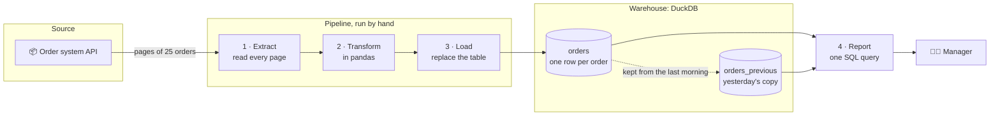
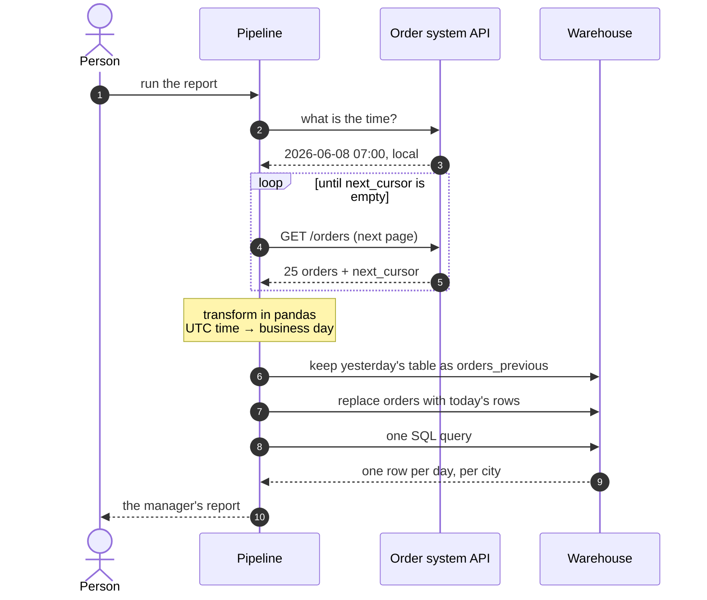

# HLD: Milestone 1, The report, by hand

**Status:** Final; built
**Satisfies:** [BRD](BRD.md)

> **What this document is.** A high-level design (HLD) names the parts of the system, what each part does, and how data moves between them. It gives no exact columns or functions. Read it after the [BRD](BRD.md). The [LLD](LLD.md) then gives the exact detail.

## 1. The approach in one picture

Read **every** order from the order system. Change it in Python. Write the result to one warehouse table. Ask that table one question in SQL.

Transform happens **before** load. That order has a name: **ETL** (extract, transform, load). It is the simplest thing that works. Section 6 says what it costs.

## 2. The five stages, and where this milestone stands

Every pipeline has the same five stages. This milestone builds a first version of four.

| Stage | Its job | In this milestone | State |
|---|---|---|---|
| **Ingest** | Copy the data in | Read every page of `GET /orders` | ✅ Built, the simple way |
| **Store** | Keep every layer of the data | One clean table. The raw copy is thrown away | ⚠️ Half built |
| **Transform** | Clean the data and add it up | pandas, then one SQL query | ✅ Built |
| **Serve** | Give the result to its readers | Printed report | ✅ Built |
| **Observe** | Check every other stage | Nothing checks anything | ❌ Not yet |

The same map is on the milestone's [flow page](../milestone_1_flow.html). Each later milestone fills in more of it.

## 3. One morning, step by step

## 4. What each part is responsible for

| Part | Responsibility | Does not do |
|---|---|---|
| **Extract** | Follow the pages to the end. Count the calls. Stop with a clear error if the API refuses | Change any value |
| **Transform** | Keep the columns the report needs. Turn `placed_at` into a business day | Talk to the API or the warehouse |
| **Load** | Replace the whole `orders` table in one step. Keep the last table as `orders_previous` | Decide what a row means |
| **Report** | Answer the four parts of the question | Change any table |

Each part can be tested alone, because each has one job.

## 5. Key design decisions

| Decision | Reason |
|---|---|
| **Full load**: read every order on every run | No memory is needed between runs. A full copy is always right, even after a cancel, a refund or a delete |
| **Batch**: one run a morning | The manager reads the report once, at 08:00. Data from 07:00 is fresh enough |
| **Event time** decides the day: `placed_at`, not the time of loading | The manager asks about the day customers ordered |
| The business day uses Arden's time zone | In UTC, 31% of orders fall on the wrong day (134 of 432) |
| The table has one row per order | That is its **grain**. Items are not needed for this question |
| Keep the last morning's table | It answers "has an earlier day changed?" and gives the order that caused it |
| DuckDB, in one file | Nothing to install or start. Postgres arrives in milestone 2 |

### Why not streaming?

| | Batch (chosen) | Streaming |
|---|---|---|
| How often it runs | Once a morning | All the time |
| Delay from event to result | Up to a day | Seconds |
| Who needs that | A manager at 08:00 | A fraud alert |
| Cost and effort | Lowest. A failed run is run again | Highest |

Nobody reads this report between 08:00 and the next morning. A faster pipeline would cost more and help no one.

## 6. What this design costs

It works. It is also wrong in three ways, and each one is felt in the lab.

| Cost | What happens | Fixed in |
|---|---|---|
| It reads everything, every day | 226 orders in 10 calls on 06-08. On 06-11 the API refuses the 13th call | Milestone 2 |
| The raw answer is thrown away | A new question about items means calling the API again. The source may have changed by then | Milestones 2 and 4 |
| Nothing checks the result | A wrong number looks the same as a right one | Milestone 4 |
| A person must start it | No report on the day they forget | Milestone 5 |

## 7. Technology

Python 3.12, `httpx` to call the API, pandas to transform, DuckDB as the warehouse, pytest for tests. The order system is a FastAPI program in the shared [`order_system/`](../../../order_system/) folder.

**No Docker is needed in this milestone.**

## 8. Risks

| Risk | Handling |
|---|---|
| The API refuses a call (429) | The pipeline stops and loads nothing. The old table stays. The error says how many calls were made |
| Two people run it on the same morning | The second run replaces the table with the same rows. `orders_previous` is not touched |
| The time zone rule is forgotten | A test compares the report with an answer key worked out separately |
