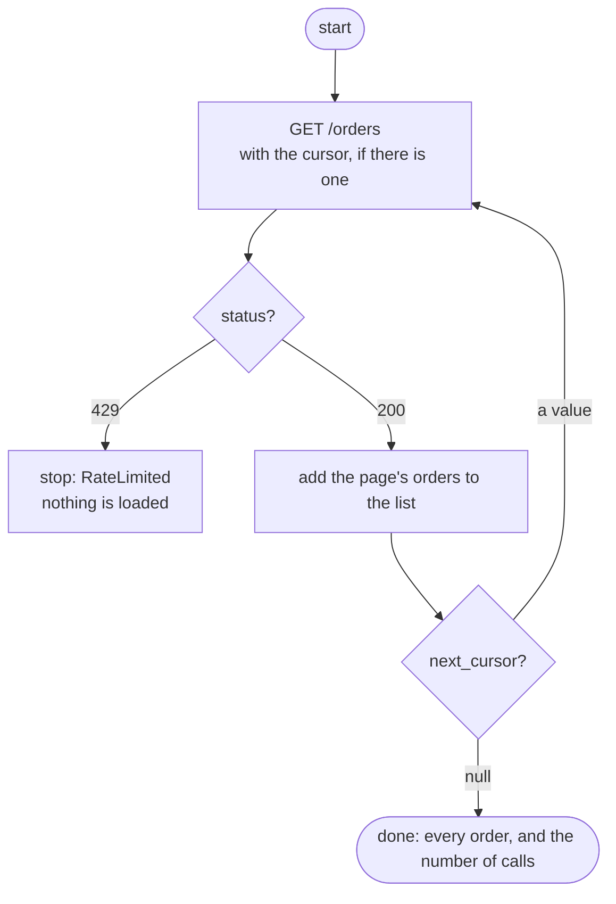
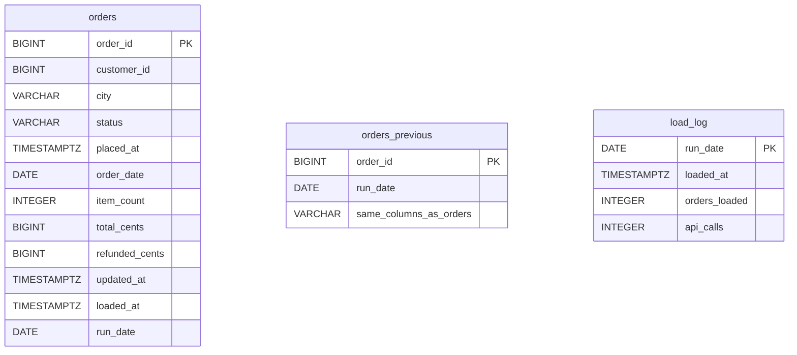

# LLD: Milestone 1, The report, by hand

**Status:** Final; built
**Fits inside:** [HLD](HLD.md)

> **What this document is.** A low-level design (LLD) gives the exact detail of each part named in the [HLD](HLD.md): the API calls, the table columns, the SQL, the functions and the checks. Keep it open beside the notebooks and the code. Section 9 says which notebook and which file build each part.

## 1. Files

Everything is inside `src/m1_report_by_hand/`. Nothing imports from another milestone.

```
docs/                     BRD.md, HLD.md, LLD.md
notebooks/                the lab: seven notebooks, run in order
  lab_helpers.py          small helpers the notebooks share
  results/answer_key.json the answer worked out by hand in notebook 3
daily_orders/             production code
  config.py               the API address, the time zone, the warehouse path
  extract.py              read every page of orders
  transform.py            orders → rows of the orders table (pandas)
  load.py                 the warehouse tables, and the load
  report.py               the report SQL and the manager's answer
  pipeline.py             one morning, start to end
  flow_data.py            builds the numbers shown on the flow page and the recap page
tests/                    one test file per code file
data/warehouse/           the DuckDB file (made when you run; not in Git)
milestone_1_flow.html     the whole pipeline, animated
milestone_1_recap.html    the closing page
```

The order system is shared by all milestones. It is in [`order_system/`](../../../order_system/) at the project root.

## 2. The source: what the API gives

| Call | Returns |
|---|---|
| `GET /orders?cursor=` | `{"data": [up to 25 orders], "next_cursor": "..." or null}` |
| `GET /admin/clock` | `{"now_utc": "...", "now_local": "2026-06-08 07:00:00", "business_time_zone": "America/Chicago"}` |
| `POST /admin/clock` | Moves the clock. Body: `{"morning": "2026-06-08"}` or `{"advance_days": 1}` |

Rules of `GET /orders`:

| Rule | Value |
|---|---|
| Order of the rows | `updated_at`, then `order_id` |
| Page size | 25 orders at most |
| End of the data | `next_cursor` is `null` |
| Rate limit | 12 calls in 10 seconds. The next call gets status `429` and a `Retry-After` header |
| Times | Always UTC, like `2026-06-07T04:58:12Z` |

One order, as it arrives:

```json
{
  "order_id": 1196, "customer_id": 1021, "city": "RVB", "status": "delivered",
  "placed_at": "2026-06-07T04:58:12Z", "updated_at": "2026-06-07T14:20:05Z",
  "delivered_at": "2026-06-07T14:20:05Z", "cancelled_at": null,
  "total_cents": 1796, "refunded_cents": 0, "refunded_at": null,
  "items": [
    {"line_no": 1, "product_id": "P-016", "product_name": "Ice cream 500ml",
     "quantity": 1, "unit_price_cents": 599, "item_status": "ok"},
    {"line_no": 2, "product_id": "P-017", "product_name": "Bananas, bunch",
     "quantity": 2, "unit_price_cents": 149, "item_status": "ok"},
    {"line_no": 3, "product_id": "P-018", "product_name": "Coffee beans 250g",
     "quantity": 1, "unit_price_cents": 899, "item_status": "ok"}
  ]
}
```

## 3. Extract (`extract.py`)



| Function | Returns |
|---|---|
| `read_run_date(client)` | The local date on the API's clock. This is the morning the run is for |
| `fetch_all_orders(client)` | `Extract(orders, api_calls)`. Raises `RateLimited` on a 429 |

This is a **full load**: it reads every row on every run.

## 4. Transform (`transform.py`)

`to_orders_table(orders, loaded_at, run_date)` returns one row per order. The table's **grain** is one order.

| Column | From | Note |
|---|---|---|
| `order_id` | `order_id` | The key |
| `customer_id`, `city`, `status` | The same fields | |
| `placed_at` | `placed_at` | **Event time**: when the customer ordered. UTC |
| `order_date` | `placed_at` | The business day. See below |
| `item_count` | `items` | Items with `item_status = "ok"` |
| `total_cents`, `refunded_cents` | The same fields | Whole cents |
| `updated_at` | `updated_at` | UTC. Not used yet. It is the hero of milestone 2 |
| `loaded_at` | The run | **Load time**: when this pipeline copied the row |
| `run_date` | The run | The morning the load was for |

The items themselves are **not kept**. Section 8 comes back to that.

### The business day

```python
order_date = placed_at.dt.tz_convert("America/Chicago").dt.date
```

| Order 1196 | Value | Day |
|---|---|---|
| `placed_at` from the API | `2026-06-07T04:58:12Z` | Sunday ❌ |
| The same moment in Arden | `2026-06-06 23:58:12` | Saturday ✅ |

The size of the mistake, on the morning of 06-08:

| Day | Right (Arden's clock) | Wrong (UTC date) |
|---|---|---|
| Sat 06-06 | 33 orders, $786.71 | 42 orders, $1,069.75 |
| Sun 06-07 | 30 orders, $807.11 | 33 orders, $810.37 |
| Mon 06-08 | no orders yet | 5 orders, $195.55 |

Every order placed after 19:00 moves to the next day. Nothing fails. The numbers are just wrong.

## 5. Load (`load.py`)

Three tables in one DuckDB file.



| Table | Holds | Rows on the morning of 06-08 |
|---|---|---|
| `orders` | Every order, as of this morning's load | 226 |
| `orders_previous` | The table of the morning before | 0 on the first run |
| `load_log` | One row per morning: how many orders, how many calls | 1 |

`replace_orders(con, table, run_date, api_calls)` does this in **one transaction**:

1. If `orders` was loaded for a different morning, copy it to `orders_previous`.
2. Delete every row of `orders`.
3. Insert the new rows.
4. Write the morning's row in `load_log`.

All four steps succeed, or none does. A reader never sees an empty table.

## 6. Report (`report.py`)

### The report table

One row per business day, per city.

```sql
SELECT
    order_date,
    city,
    count(*) FILTER (WHERE status <> 'cancelled')                         AS orders,
    count(*) FILTER (WHERE status = 'cancelled')                          AS cancelled_orders,
    coalesce(sum(total_cents - refunded_cents)
             FILTER (WHERE status <> 'cancelled'), 0)                     AS revenue_cents,
    coalesce(sum(refunded_cents) FILTER (WHERE status <> 'cancelled'), 0) AS refunded_cents
FROM orders
GROUP BY order_date, city
ORDER BY order_date, city;
```

Result for Sunday 06-07, on the morning of 06-08:

| order_date | city | orders | cancelled_orders | revenue_cents | refunded_cents |
|---|---|---|---|---|---|
| 2026-06-07 | LKS | 6 | 0 | 14498 | 0 |
| 2026-06-07 | NGT | 10 | 0 | 35526 | 0 |
| 2026-06-07 | RVB | 14 | 0 | 30687 | 0 |
| | **all** | **30** | **0** | **80711** | **0** |

### The manager's answer

| Function | Returns |
|---|---|
| `daily_report(con, table="orders")` | The rows above, for every day |
| `day_totals(report)` | The cities added together |
| `earlier_changes(con)` | Days that differ between `orders` and `orders_previous`, with the orders that caused it |
| `manager_answer(con)` | The four parts of the question, as one dictionary |
| `format_answer(answer)` | The text the manager reads |

`earlier_changes` only compares days the last report could already show: days up to two before this morning. The reason for a change is found by comparing the two tables order by order:

| What differs | Reason shown |
|---|---|
| In `orders_previous`, not in `orders` | deleted from the order system |
| Now cancelled, was not | cancelled |
| `refunded_cents` | refund of $5.78 |
| `total_cents` | total changed from $36.94 to $32.35 |

## 7. Checks

| Check | Where |
|---|---|
| The report equals the answer key, which is worked out from the source by different code | `tests/test_pipeline.py` |
| The notebook's hand-worked answer equals the production answer | `tests/test_notebook_parity.py` |
| Order 1196 lands on Saturday | `tests/test_transform.py` |
| Running the same morning twice gives the same tables | `tests/test_load.py` |
| A 429 loads nothing and keeps the old table | `tests/test_pipeline.py` |
| Every number on the flow page and the recap page comes from the code | `tests/test_flow_page.py` |

## 8. What is still wrong

Measured with this code, one full load per morning:

| Morning | Orders read | API calls | Result |
|---|---|---|---|
| 06-08 | 226 | 10 | ✅ |
| 06-09 | 251 | 11 | ✅ |
| 06-10 | 282 | 12 | ✅ the last call allowed |
| 06-11 | 317 | 13 | ❌ call 13 is refused: `429` |

On 06-09 only 25 orders were new. The load still read 251.

**It reloads every order every day. It is slow, and it hits the API's rate limit.** Milestone 2 loads only what changed.

## 9. Where each part is built

| Notebook | Teaches | Design sections | Code |
|---|---|---|---|
| `01_the_question_and_the_source` | Data pipeline, source, destination | BRD 1 to 5; LLD 2 | |
| `02_read_every_order` | Full load | LLD 3 | `extract.py` |
| `03_the_answer_by_hand` | Grain, event time, time zones | BRD 5; LLD 4 | |
| `04_transform_then_load` | ETL, the five stages | HLD 1, 2; LLD 4 to 6 | `transform.py`, `load.py`, `report.py` |
| `05_every_morning` | Load time | BRD 4; LLD 5, 6 | |
| `06_why_batch_and_where_it_breaks` | Batch, latency, freshness | HLD 5, 6; LLD 8 | |
| `07_the_production_version` | The same logic as a program | LLD 1, 7 | `pipeline.py`, `tests/` |
