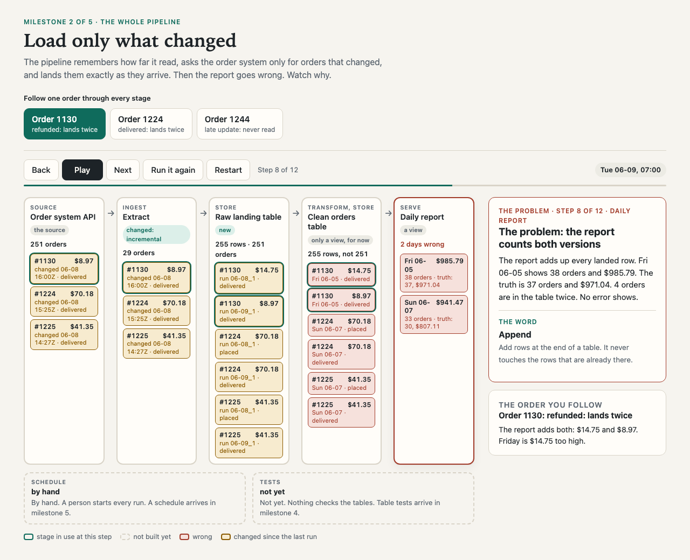

# Milestone 2: Load only what changed

**Status:** Done. Design documents, lab notebooks, production code, tests, flow page and recap page are complete.

This folder is self-contained. Nothing in it imports from another milestone.



## Why this milestone exists

Milestone 1 read every order Arden ever took, every morning. On 11 June the order system refused the load, and there was no report.

**What you build:** an incremental load. The pipeline keeps a watermark, asks the API only for orders changed since then, waits and retries when the API says no, and lands every order in Postgres exactly as it arrived.

**The outcome:** on the morning of 9 June the load reads 29 orders in 2 calls. Milestone 1 read 251 in 11. The load survives 11 June, and it survives an order system that fails twice in a row.

## The numbers

| Notebooks | Tests | Warehouse tables | Rows read on 06-09 | API calls on 06-09 | New words |
|---|---|---|---|---|---|
| 8 | 31 | 3 | 29 | 2 | 14 |

## Read it in this order

1. **[milestone_2_flow.html](milestone_2_flow.html)**: open it in a browser first, to see where you are going.
2. [docs/BRD.md](docs/BRD.md): what the business needs and why.
3. [docs/HLD.md](docs/HLD.md): the parts, and how data moves between them.
4. [docs/LLD.md](docs/LLD.md): the exact tables, SQL and functions.
5. The notebooks in `notebooks/`, from `01` to `08`.
6. The code in `daily_orders/` and `tests/`.
7. **[milestone_2_flow.html](milestone_2_flow.html)** again, to check what you built.
8. [milestone_2_recap.html](milestone_2_recap.html): a look back.

## Set up: Docker is new

This milestone needs everything milestone 1 needed, plus **Docker**. The warehouse is now Postgres.

| System | Install |
|---|---|
| macOS, Windows | [Docker Desktop](https://docs.docker.com/get-started/get-docker/) |
| Linux | Docker Engine with the Compose plugin |

Then the commands are the same on every system. From the project folder:

```sh
uv sync                          # installs the Postgres driver
docker compose up -d warehouse   # starts Postgres 16 on port 5440
uv run python -m order_system    # starts the order system; leave it running
```

The warehouse uses port 5440, so it does not clash with a Postgres you already run. To use another port, set `ARDEN_PG_PORT` before both `docker compose` and the pipeline.

## Shut it down

| You started | Stop it with |
|---|---|
| The order system, `uv run python -m order_system` | **Ctrl+C** in its terminal |
| The warehouse, `docker compose up -d warehouse` | `docker compose down`, from the project folder |

`docker compose down` keeps the warehouse data. Add `-v` to delete it too.

## The lab

Open the notebooks in VS Code, choose the project's `.venv` as the kernel, and run them in order. The order system and the warehouse must be running.

| Notebook | What you do | New words |
|---|---|---|
| `01_ask_only_for_what_changed` | Read the orders that changed, not all of them | Incremental load, incremental key |
| `02_remember_where_you_stopped` | Keep a watermark. See what happens when it moves too early | Watermark |
| `03_when_the_api_says_no` | Meet the rate limit and a server error. Wait, and try again | Pagination, rate limit, retry with backoff |
| `04_land_it_raw` | Put every order in Postgres, exactly as it arrived | Raw landing table, load metadata, append |
| `05_pull_or_push` | A short lab: let the order system send the changes to you | Pull, push, polling |
| `06_what_you_built_has_a_name` | Change data capture, and what this kind cannot see | CDC, query-based CDC |
| `07_counted_twice` | Run a few mornings. Watch the report go wrong | |
| `08_the_production_version` | The same logic as a tested program | |

Notebook 3 really waits about ten seconds in one cell, to show a real rate limit. Notebook 5 opens port 8011 on your computer for a few minutes.

## Run the program

In a second terminal, from this folder:

```sh
uv run python -m order_system.clock --morning 2026-06-08
uv run python -m daily_orders          # the first load reads everything
uv run python -m order_system.clock --advance-days 1
uv run python -m daily_orders          # the second load reads only what changed
```

It writes to the database `arden_m2`. To look inside:

```sh
docker exec -it arden-warehouse psql -U arden -d arden_m2 -c "SELECT * FROM ops.load_runs"
```

## Run the tests

```sh
uv run pytest
```

The tests start their own private order system and use their own database. The warehouse must be running.

## The pages show real numbers

```sh
uv run python -m daily_orders.flow_data
```

This runs the real pipeline and writes what happened into the flow page and the recap page. A test fails when a page is out of date.

## Five things you learn

1. Read only what changed, by a key that changes with the row.
2. The watermark is the largest value you loaded, not the time the job ran.
3. Save the watermark with the rows, in one transaction.
4. Retry what a retry can fix, and cap the tries.
5. Land raw first, exactly as received.

## New words

| Word | Meaning |
|---|---|
| **Incremental load** | It reads only rows that are new or changed |
| **Incremental key** | The column that says a row changed. Here: `updated_at` |
| **Watermark** | The saved value that marks how far the last run read. Also called a high-water mark |
| **Pagination** | An API returns rows in pages. You ask again until it says it is done |
| **Rate limit** | A cap on how many calls you may make in a period |
| **Retry with backoff** | Try a failed call again, and wait longer each time. Always cap the tries |
| **Raw landing table** | The raw copy of what arrived |
| **Load metadata** | Columns about the load, not the data: which run, when |
| **Append** | Add rows at the end of a table. Never touch the rows already there |
| **Pull**, **push** | Who starts the transfer: your job, or the source |
| **Polling** | Asking again and again: what is new? |
| **Change data capture (CDC)** | Capturing each change to a table. A watermark load is query-based CDC |

Each word has an interview line in the project's [GLOSSARY.md](../../GLOSSARY.md).

## Still wrong

> A changed order is now in the table twice, and the report counts it twice. Run the load two times and it is worse.

After two mornings, 4 orders are in the table twice. Friday 5 June shows 38 orders and $985.79. The truth is 37 orders and $971.04. Milestone 3 makes the load safe to run twice.
