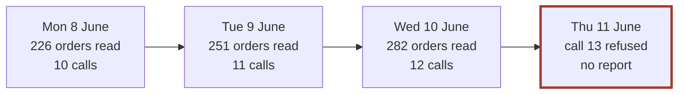

# BRD: Milestone 2, Load only what changed

**Status:** Final; built
**Milestone:** 2 of 5 (see the project [README](../../../README.md#milestones))

> **What this document is.** A business requirements document (BRD) says what the business needs and why, in business words. Read it first. Next, read the [HLD](HLD.md) to see what gets built.

## 1. The business problem

Milestone 1 made the manager's report with a program. It read **every order Arden ever took**, every morning.

On the morning of Thursday 11 June that stopped working. The order system refused the load, and the manager had no report.

Most of that reading was wasted. On Tuesday the load read 251 orders. Only 29 of them were new or changed.

## 2. What the business needs

| # | Need | Why |
|---|---|---|
| 1 | Read only the orders that are new or changed | So the load stays small as Arden grows |
| 2 | A report every morning, also when the order system is slow or busy | The manager plans drivers and stock from it |
| 3 | Keep everything the order system sent, exactly as it was sent | So a new question can be answered without asking the order system again |
| 4 | Know which run loaded each row, and when | So a wrong number can be traced back |

## 3. The people

| Person | What they need from this milestone |
|---|---|
| 👩‍💼 Operations manager | A report on 11 June, and every morning after |
| 💰 Finance | The old version of an order kept beside the new one, to explain a change |
| 🧑‍🔧 Owner of the order system | Fewer calls. A load that waits when told to wait |
| 🎓 Learner | The same pipeline, changed in one place: how much it reads |

## 4. Business rules

The rules of milestone 1 still hold: the business day, which orders count, and how money is added up. Two rules are new.

| Rule | Decision |
|---|---|
| "Changed" | An order is changed when the order system updated it since the last load. The order system marks this in `updated_at` |
| Nothing may be lost | If an order could be read twice or missed, read it twice |
| A failed load | Loads nothing. The next run starts from the same place |
| The raw copy | Is never edited and never deleted |

## 5. Scope

**In scope:** an incremental load, retries, a raw landing table in Postgres, and two short labs (push, and the name CDC).

**Out of scope for this milestone:**

| Not yet | Arrives in |
|---|---|
| One row per order, however often it was loaded | Milestone 3 |
| Updates that reach the order system late | Milestone 3 |
| Orders deleted from the order system | Milestone 3 |
| Models and tests on the tables | Milestone 4 |
| A schedule | Milestone 5 |

## 6. Success criteria

- On the morning of 9 June the load reads **29** orders in **2** calls. Milestone 1 read 251 in 11.
- The load runs every morning from 8 to 12 June. On 11 June it does not fail.
- When the order system fails three times in a row, the load waits and then finishes.
- Every landed row says which run loaded it, on which page, and when.
- The refunded order 1130 is in the warehouse **twice**: once before the refund and once after.

## 7. What this milestone knowingly leaves wrong

The last success criterion is also the problem. A changed order is now in the table twice, so the report counts it twice.

| Day | The truth | The report after two mornings |
|---|---|---|
| Fri 5 June | 37 orders, $971.04 | 38 orders, $985.79 |
| Sun 7 June | 30 orders, $807.11 | 33 orders, $941.47 |

The business accepts this for one milestone only. Milestone 3 makes one order one row.

## 8. Assumptions

- All data is fictional and generated.
- The order system sets `updated_at` on every change. Milestone 3 shows the two cases where that is not enough.
- Docker is installed, because the warehouse is now Postgres.
