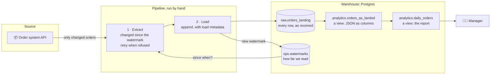
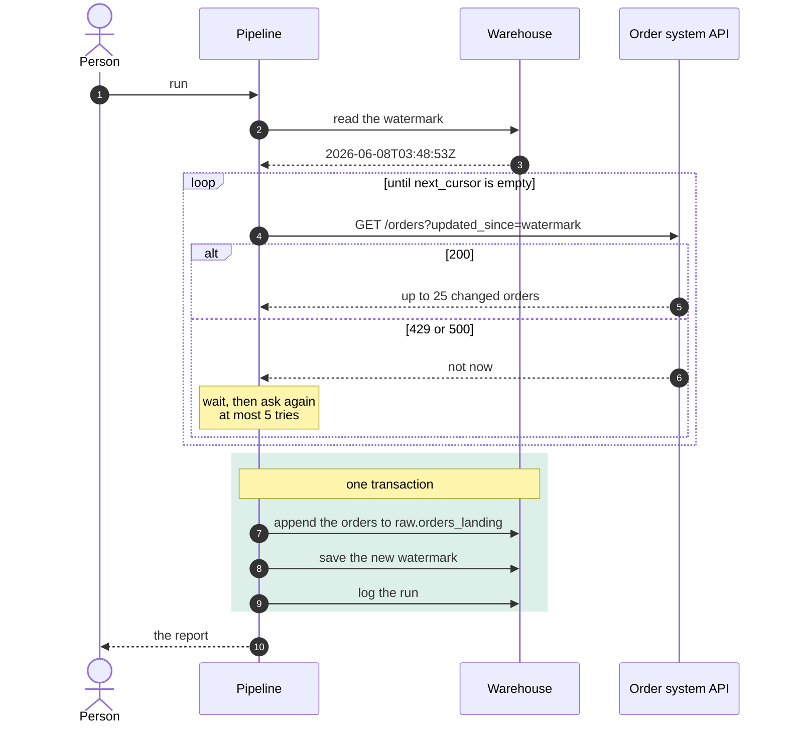

# HLD: Milestone 2, Load only what changed

**Status:** Final; built
**Satisfies:** [BRD](BRD.md)

> **What this document is.** A high-level design (HLD) names the parts of the system, what each part does, and how data moves between them. Read it after the [BRD](BRD.md). The [LLD](LLD.md) then gives the exact detail.

## 1. The approach in one picture

Remember how far the last run read. Ask the order system only for orders changed since then. Land them exactly as they arrive.

## 2. What changed since milestone 1

| Part | Milestone 1 | Milestone 2 |
|---|---|---|
| How much is read | Every order, every run (full load) | Orders changed since the watermark (**incremental load**) |
| When the API refuses | Stop. No report | Wait, then try again (**retry with backoff**) |
| What is stored | 12 chosen columns. The rest is thrown away | The whole order, as received (**raw landing table**) |
| How rows are written | Replace the whole table | Add rows at the end (**append**) |
| What each row remembers | Nothing about its load | Run, page and time (**load metadata**) |
| Warehouse | DuckDB, one file | Postgres, in Docker |
| The report | Right | **Wrong.** See section 7 |

## 3. The five stages now

| Stage | In this milestone | State |
|---|---|---|
| **Ingest** | Incremental, with a watermark and retries | ✅ Built |
| **Store** | A raw layer that keeps everything | ✅ Built: the raw layer |
| **Transform** | Two views. No clean table yet | ⚠️ Too simple |
| **Serve** | The report view | ⚠️ Counts changed orders twice |
| **Observe** | A log of every run | ⚠️ A start |

## 4. One morning, step by step

The green box is the important part. The rows and the watermark are saved **together or not at all**.

## 5. Why the watermark is saved with the data

Two ways to get it wrong:

| Order of steps | If the job crashes between them | Result |
|---|---|---|
| Save the watermark, then the rows | The watermark has moved. The rows are not there | ❌ Rows are lost for ever. No error shows |
| Save the rows, then the watermark | The rows are there. The watermark has not moved | ⚠️ The next run reads them again: duplicates |
| **Both in one transaction** (chosen) | Neither is saved | ✅ The next run starts from the same place |

## 6. Key design decisions

| Decision | Reason |
|---|---|
| The **incremental key** is `updated_at` | It changes whenever the order changes. `placed_at` would miss every refund and cancel |
| The watermark is the **largest `updated_at` read**, not the time of the run | The clock of the job and the clock of the source are never exactly the same |
| The filter includes the boundary (`>=`) | Two orders can change in the same second. `>` would lose one. `>=` reads one again |
| Retry only what a retry can fix | 429 and 500 to 504: wait and retry. 400: our mistake, stop at once |
| Always cap the tries (5) | A job that retries for ever hides a broken source |
| Land the whole order as JSON | The source can add a field tomorrow. The landing table still takes it |
| **Pull**, not push | The pipeline decides when it runs. A push that is missed is silent. A lab shows both |
| The report is a view on the landing table | The simplest thing. It is also what breaks. Milestone 3 replaces it |

### What this load is called

Reading rows by "changed since my watermark" is **polling**: you ask the source again and again what is new. It is also the simplest kind of **change data capture (CDC)**: query-based CDC.

| Kind of CDC | How it works | Sees deletes? | Sees every update? |
|---|---|---|---|
| **Query-based** (this milestone) | Poll with an `updated_at` query | No | No. Only the latest state |
| Trigger-based | The database writes each change to a change table | Yes | Yes |
| Log-based | Read the database's own log of changes | Yes | Yes |

Milestone 3 meets a deleted order, and shows why the bottom row exists.

## 7. What this design costs

| Cost | What happens | Fixed in |
|---|---|---|
| A changed order is in the table twice | After two mornings, 4 orders are there twice. Friday shows 38 orders, not 37 | Milestone 3 |
| Every extra run adds a row | The boundary order is read again and appended again | Milestone 3 |
| A repeated page doubles its orders | On 11 June the API serves page 2 twice: 49 rows for 37 orders | Milestone 3 |
| A late update is never read | Order 1244 was cancelled before the watermark, and shown after it | Milestone 3 |
| A deleted order stays | Nothing in `updated_at` says an order is gone | Milestone 3 |

Everything this milestone does is **safe from loss**. Nothing it does is safe from repeats.

## 8. Technology

Python 3.12, `httpx`, Postgres 16 in Docker Compose, `psycopg` 3, pytest. pandas and DuckDB are no longer used by the pipeline.

**New to install: Docker.** The warehouse listens on port 5440 of your computer.

## 9. Risks

| Risk | Handling |
|---|---|
| The API fails for a long time | 5 tries, then a clear error. Nothing is landed and the watermark stays |
| The landing table grows for ever | Accepted here. It is small. A real team would move old runs to cheap storage |
| The tests need a running warehouse | They stop at once with the command that starts it |
