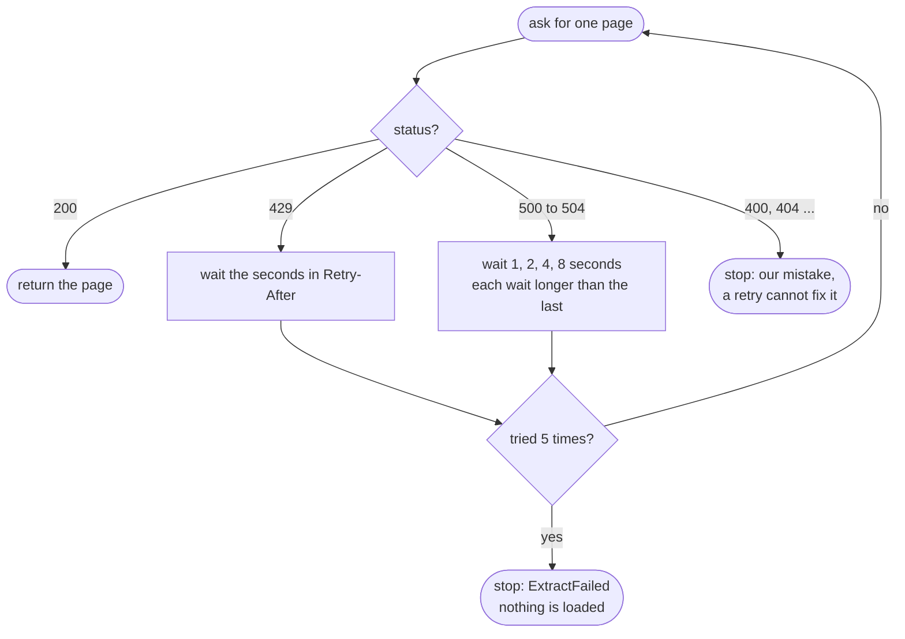
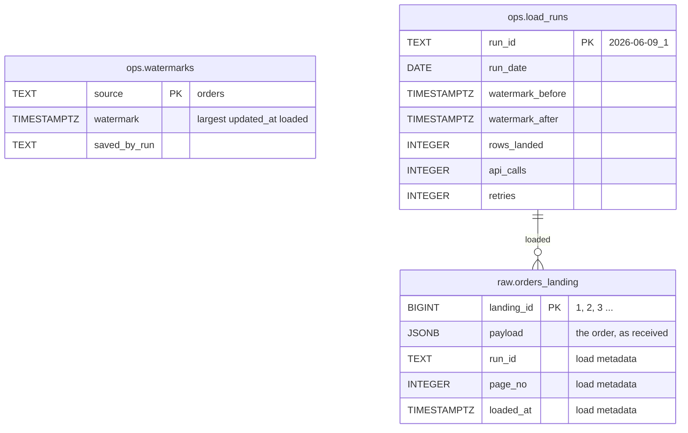

# LLD: Milestone 2, Load only what changed

**Status:** Final; built
**Fits inside:** [HLD](HLD.md)

> **What this document is.** A low-level design (LLD) gives the exact detail of each part named in the [HLD](HLD.md). Keep it open beside the notebooks and the code. Section 9 says which notebook and which file build each part.

## 1. Files

Everything is inside `src/m2_load_only_what_changed/`. Nothing imports from another milestone.

```
docs/                     BRD.md, HLD.md, LLD.md
notebooks/                the lab: eight notebooks, run in order
  lab_helpers.py          small helpers the notebooks share
daily_orders/             production code
  config.py               addresses, the retry settings
  extract.py              ask for changed orders; retry with backoff
  warehouse.py            the Postgres database, its tables and views
  load.py                 land the rows and move the watermark
  report.py               read the report
  pipeline.py             one morning, start to end
  flow_data.py            builds the numbers shown on the flow page and the recap page
tests/                    one test file per code file
milestone_2_flow.html     the whole pipeline, animated
milestone_2_recap.html    the closing page
```

The warehouse is started by `docker-compose.yml` at the project root.

## 2. The source: what is new in the API

| Call | Returns |
|---|---|
| `GET /orders?updated_since=2026-06-08T03:48:53Z` | Only orders with `updated_at` **at or after** that time |
| `POST /admin/faults` | Makes the next calls fail. Body: `{"kind": "error_500", "count": 3}` |
| `POST /webhooks` | Lab only: registers an address that receives each change |

| Fault | What the next calls do |
|---|---|
| `error_500` | Answer 500, the server failed |
| `rate_limit` | Answer 429 with `Retry-After: 1` |
| `repeat_page` | Serve one page twice |

One fault is planted in the data: in every run of **2026-06-11**, the second page is served twice.

## 3. Extract (`extract.py`)



| Function | Returns |
|---|---|
| `fetch_changed_orders(client, updated_since, sleep)` | `Extract(orders, pages, api_calls, retries, waited_seconds)`. `updated_since=None` reads everything |
| `get_page(client, params, extract, sleep)` | One page, after as many tries as it needs |

`sleep` is passed in, so a test can count the waits without waiting.

## 4. The warehouse (`warehouse.py`)

One Postgres database, `arden_m2`, with three schemas.



| Schema | Holds | Who writes |
|---|---|---|
| `raw` | Data exactly as it arrived | Only the load. Only by adding rows |
| `ops` | What the pipeline remembers about itself | Only the load |
| `analytics` | What people read | Nobody. It holds views |

Two views sit on the landing table:

| View | Grain | What it does |
|---|---|---|
| `analytics.orders_as_landed` | One row per **landed row** | Turns the JSON into columns. Works out `order_date` in Arden's time zone |
| `analytics.daily_orders` | One row per day, per city | The report. It adds up every landed row |

The grain of the first view is the trap. It is not one row per order.

## 5. Load (`load.py`)

`land(...)` does three things in **one transaction**:

```sql
INSERT INTO raw.orders_landing (payload, run_id, page_no, loaded_at) VALUES ...;   -- append

INSERT INTO ops.watermarks (source, watermark, saved_by_run)
VALUES ('orders', <largest updated_at read>, <run_id>)
ON CONFLICT (source) DO UPDATE
    SET watermark = greatest(ops.watermarks.watermark, EXCLUDED.watermark),        -- never moves back
        saved_by_run = EXCLUDED.saved_by_run;

INSERT INTO ops.load_runs VALUES (...);                                             -- the log
```

| Rule | How |
|---|---|
| The watermark is the largest `updated_at` read | Not `now()`. Not the time of the run |
| A run that reads nothing keeps the watermark | The first `INSERT` adds nothing, the second is skipped |
| The watermark never moves back | `greatest(old, new)` |
| A run id is readable | `2026-06-09_2` is the second run of that morning |

## 6. Two mornings, on real rows

```mermaid
gantt
    dateFormat YYYY-MM-DD HH:mm
    axisFormat %a %H:%M
    section Order 1130
    placed, delivered (Fri)      :done, 2026-06-05 10:20, 5h
    refunded $5.78 (Mon 11:00)   :crit, milestone, 2026-06-08 11:00, 0h
    section Runs
    run 2026-06-08_1 lands version 1 :active, milestone, 2026-06-08 07:00, 0h
    run 2026-06-09_1 lands version 2 :active, milestone, 2026-06-09 07:00, 0h
```

| Run | Watermark before | Asked the API for | Rows landed | Calls | Watermark after |
|---|---|---|---|---|---|
| `2026-06-08_1` | none | everything | 226 | 10 | `2026-06-08T03:48:53Z` |
| `2026-06-09_1` | `2026-06-08T03:48:53Z` | changed since then | 29 | 2 | `2026-06-09T04:17:31Z` |
| `2026-06-09_2` (run again) | `2026-06-09T04:17:31Z` | changed since then | 1 | 1 | the same |

After the second run the landing table holds order 1130 twice:

| landing_id | order_id | total_cents | refunded_cents | run_id |
|---|---|---|---|---|
| 137 | 1130 | 1475 | 0 | `2026-06-08_1` |
| 232 | 1130 | 1475 | 578 | `2026-06-09_1` |

Both rows are true. The first is what the order **was**. The second is what it **is**. That history is worth keeping. The mistake is to add both up.

## 7. Checks

| Check | Where |
|---|---|
| Only changed orders come back, and the boundary order is read again | `tests/test_extract.py` |
| A 500 is retried with waits of 1, 2, 4 seconds. A 400 is not retried | `tests/test_extract.py` |
| After 5 failed tries the extract stops | `tests/test_extract.py` |
| Rows land exactly as received, with load metadata | `tests/test_load.py` |
| Rows and watermark are saved together or not at all | `tests/test_load.py` |
| A failed extract lands nothing, and the next run loses nothing | `tests/test_pipeline.py` |
| The load survives 11 June | `tests/test_pipeline.py` |
| What is still wrong, measured (section 8) | `tests/test_pipeline.py` |
| Every number on the pages comes from the code | `tests/test_flow_page.py` |

## 8. What is still wrong

Measured with this code, after the runs of 8 and 9 June:

| | Rows in the landing table | Different orders | In the table twice |
|---|---|---|---|
| After two mornings | 255 | 251 | 4 |

| Day | The truth | The report | Why |
|---|---|---|---|
| Fri 06-05 | 37 orders, $971.04 | 38 orders, $985.79 | Order 1130 is counted before and after its refund |
| Sun 06-07 | 30 orders, $807.11 | 33 orders, $941.47 | Three evening orders changed status the next morning |

And it gets worse:

| What you do | What happens |
|---|---|
| Run 9 June a second time | 1 more row. Monday shows 26 orders, not 25 |
| Run 11 June | The API serves page 2 twice. 49 rows land for 37 orders |

**A changed order is now in the table twice, and the report counts it twice. Run the load two times and it is worse.** Milestone 3 makes the load safe to run twice.

## 9. Where each part is built

| Notebook | Teaches | Design sections | Code |
|---|---|---|---|
| `01_ask_only_for_what_changed` | Incremental load, incremental key | BRD 1, 2; HLD 2 | `extract.py` |
| `02_remember_where_you_stopped` | Watermark | HLD 5, 6; LLD 5 | `load.py` |
| `03_when_the_api_says_no` | Pagination, rate limit, retry with backoff | LLD 2, 3 | `extract.py` |
| `04_land_it_raw` | Raw landing table, load metadata, append | HLD 1; LLD 4, 5 | `warehouse.py`, `load.py` |
| `05_pull_or_push` | Pull, push, polling | HLD 6 | |
| `06_what_you_built_has_a_name` | Change data capture | HLD 6; LLD 6 | |
| `07_counted_twice` | What is still wrong | BRD 7; LLD 8 | `report.py` |
| `08_the_production_version` | The same logic as a program | LLD 1, 7 | `pipeline.py`, `tests/` |
