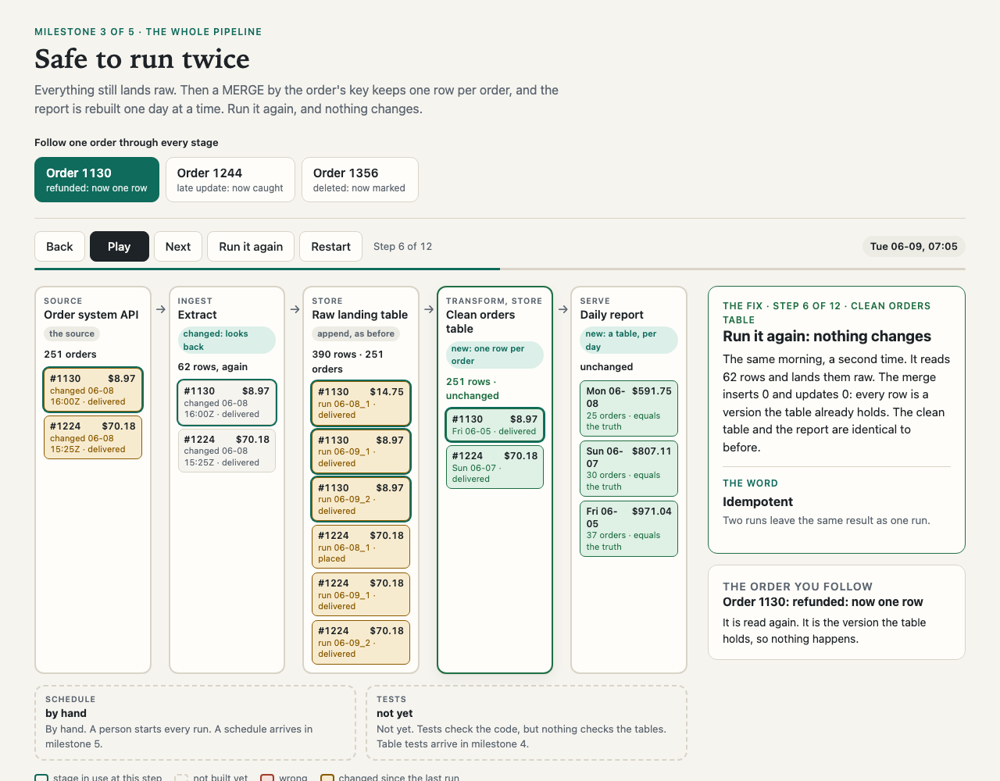

# Milestone 3: Safe to run twice

**Status:** Done. Design documents, lab notebooks, production code, tests, flow page and recap page are complete.

This folder is self-contained. Nothing in it imports from another milestone.



## Why this milestone exists

After milestone 2 a changed order was in the table twice, and the report counted it twice. Running the load a second time made it worse.

**What you build:** a clean orders table with one row per order, written by `MERGE` on the order's key. A report table rebuilt one business day at a time. A lookback for changes that arrive late. A soft delete for orders that vanish from the source.

**The outcome:** the report equals the answer key on every morning from 2 to 18 June. Running a morning twice, or five times, changes nothing.

## The numbers

| Notebooks | Tests | Warehouse tables | Orders after two mornings | Rows for them | New words |
|---|---|---|---|---|---|
| 8 | 29 | 6 | 251 | 251 | 18 |

## Read it in this order

1. **[milestone_3_flow.html](milestone_3_flow.html)**: open it in a browser first. Press **Run it again**.
2. [docs/BRD.md](docs/BRD.md): what the business needs and why.
3. [docs/HLD.md](docs/HLD.md): the parts, and how data moves between them.
4. [docs/LLD.md](docs/LLD.md): the exact tables, SQL and functions.
5. The notebooks in `notebooks/`, from `01` to `08`.
6. The code in `daily_orders/` and `tests/`.
7. **[milestone_3_flow.html](milestone_3_flow.html)** again, to check what you built.
8. [milestone_3_recap.html](milestone_3_recap.html): a look back.

## Set up

Nothing new to install. The commands are the same on macOS, Linux and Windows. From the project folder:

```sh
docker compose up -d warehouse   # Postgres 16 on port 5440. MERGE needs Postgres 15 or later
uv run python -m order_system    # the order system; leave it running
```

## Shut it down

| You started | Stop it with |
|---|---|
| The order system, `uv run python -m order_system` | **Ctrl+C** in its terminal |
| The warehouse, `docker compose up -d warehouse` | `docker compose down`, from the project folder |

`docker compose down` keeps the warehouse data. Add `-v` to delete it too.

## The lab

Open the notebooks in VS Code, choose the project's `.venv` as the kernel, and run them in order. The order system and the warehouse must be running.

| Notebook | What you do | New words |
|---|---|---|
| `01_one_order_one_row` | Write the same rows three ways: append, overwrite, upsert | Upsert, MERGE, overwrite |
| `02_which_column_is_the_key` | Merge on the wrong key. Then meet an order that arrives twice in one run | Primary key, natural key, dedupe key |
| `03_run_it_twice` | Prove that a second run changes nothing | Idempotent, safe re-run |
| `04_at_least_once_exactly_once` | Crash the load in three places, and see what each one costs | At-most-once, at-least-once, exactly-once |
| `05_the_update_that_came_late` | Find a change the watermark has passed. Catch it with a lookback | Late row, lookback |
| `06_fix_one_day` | Break Friday's numbers, and rebuild Friday alone | Partition, reprocessing |
| `07_the_order_that_vanished` | A deleted order, and why the query cannot see it | Hard delete, soft delete, log-based CDC |
| `08_the_production_version` | The three properties, as tests | |

Notebook 7 reads every order a few times, and the API's rate limit makes it wait. It takes about a minute.

## Run the program

In a second terminal, from this folder:

```sh
uv run python -m order_system.clock --morning 2026-06-08
uv run python -m daily_orders          # the first load
uv run python -m order_system.clock --advance-days 1
uv run python -m daily_orders          # only what changed; Friday moves, with a reason
uv run python -m daily_orders          # again: 0 new, 0 updated
```

To rebuild the report for one business day, and no other:

```sh
uv run python -m daily_orders --rebuild-day 2026-06-05
```

It writes to the database `arden_m3`.

## Run the tests

```sh
uv run pytest
```

The three properties each have a test:

| Property | Test |
|---|---|
| Run it twice and nothing changes | `test_running_the_same_morning_twice_changes_nothing` |
| Re-run an old day and that day is corrected | `test_rebuilding_one_day_corrects_it_and_touches_no_other` |
| An order cancelled later lowers the old day's total | `test_an_order_cancelled_later_lowers_the_old_days_total` |

## The pages show real numbers

```sh
uv run python -m daily_orders.flow_data
```

## Five things you learn

1. Do not stop the repeats. Make the write not care.
2. Check the key before you merge.
3. Prove idempotency with a test.
4. A lookback is only safe with an idempotent write.
5. A query cannot see a row that is gone.

## New words

| Word | Meaning |
|---|---|
| **Upsert**, **MERGE** | Update the row if the key exists, add it if not. `MERGE` is the SQL statement for it |
| **Overwrite** | Empty the table and load everything. Right for a full load only |
| **Primary key**, **natural key** | The column the database keeps unique. A key that comes from the business itself |
| **Dedupe key** | The key you keep one row per, when a thing arrived more than once |
| **Idempotent**, **safe re-run** | Two runs leave the same result as one run |
| **At-most-once**, **at-least-once**, **exactly-once** | A row can be lost. A row can repeat. Each row changes the result one time |
| **Late row**, **lookback** | A row that arrives after the window that should have caught it. Re-reading N days before the watermark |
| **Partition**, **reprocessing** | One slice of a table, here one day. Building a past slice again |
| **Hard delete**, **soft delete** | Remove the row for good. Keep the row and mark it |
| **Log-based CDC** | Capturing changes from the database's own log. It sees deletes |

Each word has an interview line in the project's [GLOSSARY.md](../../GLOSSARY.md).

## A note on deletes

The pipeline learns about deleted orders from a **change feed** in the fake order system. This is a stand-in. A real company would read the source database's own log with a log-based CDC tool such as Debezium. The project does not build that.

## Still wrong

> All the logic is in one script. Nothing checks the tables. Nobody knows when the number is wrong.

Milestone 4 moves the SQL into dbt models, and puts tests on the tables.
