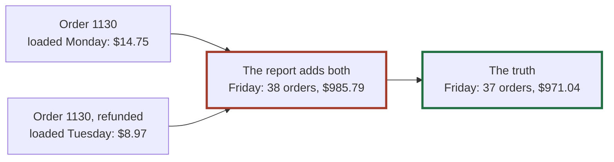

# BRD: Milestone 3, Safe to run twice

**Status:** Final; built
**Milestone:** 3 of 5 (see the project [README](../../../README.md#milestones))

> **What this document is.** A business requirements document (BRD) says what the business needs and why, in business words. Read it first. Next, read the [HLD](HLD.md) to see what gets built.

## 1. The business problem

After milestone 2 the load is small and it survives a busy order system. But the report is wrong, and it is wrong in a way nobody can see.

This is the second of the three things that went wrong at Arden: **sales were counted twice.** Someone ran the load two times on one morning, and the report doubled.

## 2. What the business needs

| # | Need | Why |
|---|---|---|
| 1 | One order is counted once, however often it is loaded | A changed order must replace its old version, not sit beside it |
| 2 | Running the load twice changes nothing | A person, or a retry, must never be able to double a number |
| 3 | An old day can be made right again, alone | Finance must be able to fix Friday without touching Thursday |
| 4 | A change that reaches the order system late still arrives | A driver's phone can be offline for hours |
| 5 | An order deleted from the order system leaves the report | A test order is not a sale |
| 6 | Every change to an old number has a reason | Finance must explain it |

## 3. The people

| Person | What they need from this milestone |
|---|---|
| 👩‍💼 Operations manager | The same number, whoever ran the report and however often |
| 💰 Finance | A reason for every change to an earlier day, and a way to re-run one day |
| 🏙️ City managers | No cancelled-at-the-door order counted as a sale |
| 🎓 Learner | Proof, by tests, that the pipeline is safe to run twice |

## 4. Business rules

The rules of milestones 1 and 2 still hold. These are new.

| Rule | Decision |
|---|---|
| The identity of an order | Its `order_id`. Two rows with the same `order_id` are the same order |
| Which version counts | The newest one: the largest `updated_at` |
| A deleted order | Is marked as deleted and kept. It is not counted. Nobody removes the row |
| How late a change may be | The latest so far was 12 hours and 40 minutes. The load looks back 2 days |
| Re-running a day | Replaces that day's numbers. It never adds to them |

## 5. Scope

**In scope:** a clean orders table with one row per order, a report table rebuilt one day at a time, a lookback for late changes, deletes, and proof by tests.

**Out of scope for this milestone:**

| Not yet | Arrives in |
|---|---|
| The transform as models, with tests on the tables | Milestone 4 |
| A schedule, retries of a whole run, backfills by command | Milestone 5 |

## 6. Success criteria

Three properties, each proved by a test and not by a claim.

| # | Property | The proof |
|---|---|---|
| 1 | **Run it twice and nothing changes** | Run 9 June twice, then five times. The orders table and the report are identical to one run |
| 2 | **Re-run an old day and that day is corrected** | Break Friday's numbers by hand. Rebuild Friday. It is right again, and no other day was touched |
| 3 | **An order cancelled later lowers the old day's total** | Order 1091, placed 3 June, is cancelled on 4 June. The next run lowers 3 June by 1 order and $20.56 |

And the report must equal the answer key **on every morning from 2 June to 18 June**. In milestone 2 it was wrong from the second morning on.

## 7. Assumptions

- All data is fictional and generated.
- The order system can tell us which orders were deleted. Here that is a change feed in the fake API. A real company would read the database's own log.
- Two days of lookback is enough. If a change ever arrives later than that, it is missed. This is a decision, and it is written down.
