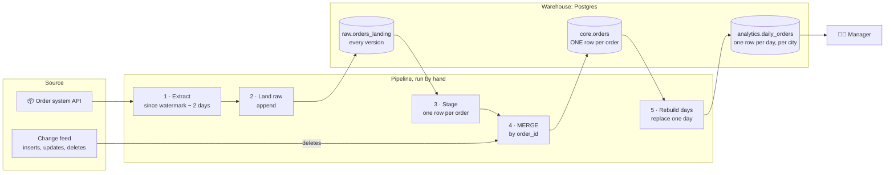
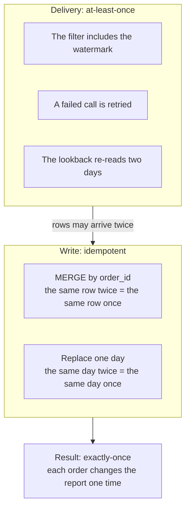
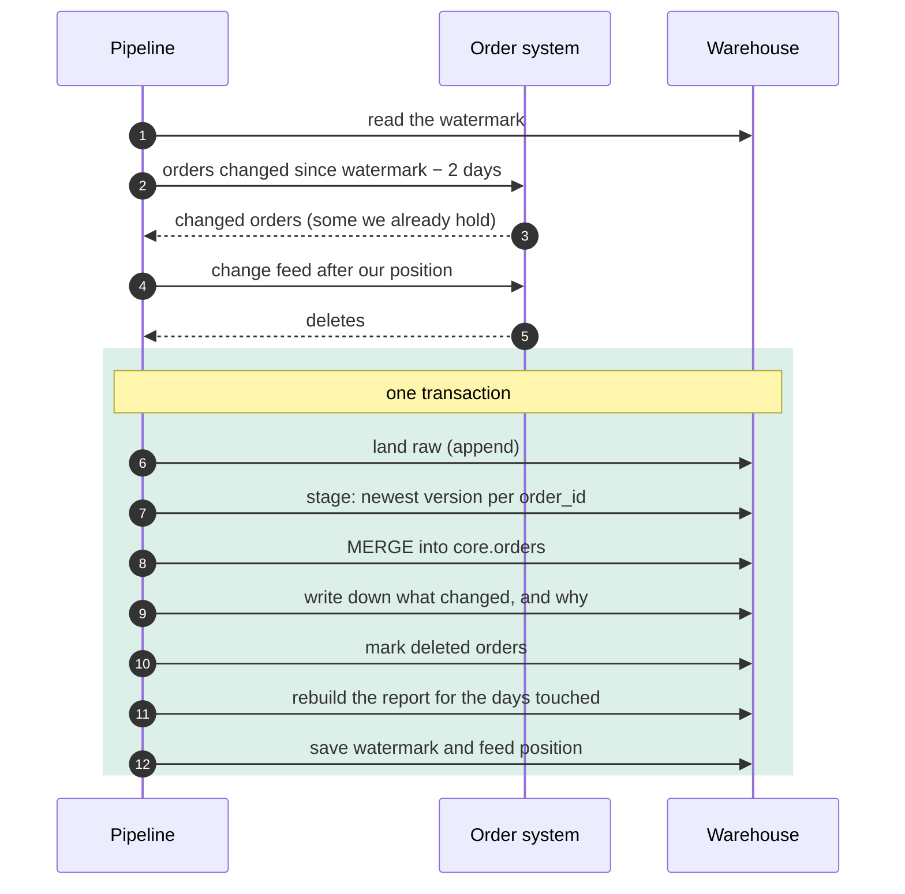

# HLD: Milestone 3, Safe to run twice

**Status:** Final; built
**Satisfies:** [BRD](BRD.md)

> **What this document is.** A high-level design (HLD) names the parts of the system, what each part does, and how data moves between them. Read it after the [BRD](BRD.md). The [LLD](LLD.md) then gives the exact detail.

## 1. The approach in one picture

Keep landing everything raw. Then **upsert** it into a clean table by the order's key, so one order is always one row. Build the report from that table, one day at a time.

## 2. What changed since milestone 2

| Part | Milestone 2 | Milestone 3 |
|---|---|---|
| The clean orders table | A view on the landing table | A real table, one row per order (**upsert with `MERGE`**) |
| A changed order | Two rows, counted twice | One row, updated |
| Running twice | Adds rows. The report gets worse | Changes nothing (**idempotent**) |
| A repeated page | Doubles its orders | No effect (**exactly-once result**) |
| A late update | Never read | Read by the **lookback** |
| A deleted order | Stays for ever | Marked (**soft delete**) and not counted |
| The report | A view that adds up everything | A table, rebuilt **one day at a time** |
| Why a number moved | Unknown | Written down, order by order |

## 3. The idea that makes it safe

Milestone 2 was safe from **loss**, and paid for it with **repeats**. This milestone does not stop the repeats. It makes the write not care.

| Promise | It means | Can lose a row? | Can repeat a row? |
|---|---|---|---|
| At-most-once | Never send again | Yes | No |
| **At-least-once** (our delivery) | Send again until it worked | No | Yes |
| **Exactly-once** (our result) | Each row changes the result one time | No | No |

Exactly-once is not something a network can give you. It is at-least-once delivery **plus** an idempotent write.

## 4. One morning, step by step

Everything in the green box is saved together, or not at all. A crash in the middle leaves the warehouse exactly as it was.

## 5. What each part is responsible for

| Part | Responsibility | Why it is safe to repeat |
|---|---|---|
| **Land raw** | Append every row as received | It is not. The raw table grows on every run, on purpose. Nobody counts from it |
| **Stage** | Keep one row per `order_id`: the newest version | It only reads |
| **MERGE** | Insert a new order. Update a known order when the version is newer | The same version matches no rule, so the row is left alone |
| **Soft delete** | Mark a deleted order. Keep the row | An order already marked is skipped |
| **Rebuild days** | Delete a day's report rows, then insert them again | The day is replaced, never added to |
| **Save progress** | Move the watermark and the feed position | Neither ever moves back |

## 6. Key design decisions

| Decision | Reason |
|---|---|
| The key is `order_id`, a **natural key** | It comes from the business itself, and it is unique for an order |
| `MERGE`, not `INSERT ... ON CONFLICT` | Both upsert. `MERGE` is the form other warehouses share, and it reads as the business rule does |
| The raw table stays append-only | It is the record of what arrived. Fixing the layer above does not need the source |
| Update only when the version is **newer** | A lookback re-reads old versions. They must not overwrite newer ones |
| Lookback of **2 days** | The latest change so far was 12 hours 40 minutes late. Two days leaves room, and costs about 70 extra rows a run |
| Deletes are **soft** | The row stays, marked. Finance can still see what was deleted, and when |
| Deletes come from a change feed | A deleted row has no `updated_at` to find. Only the source's own list of changes knows |
| The report is replaced **per day** | One day is one partition. A day can be fixed alone |

### What the lookback costs

Measured on the morning of 9 June:

| Load | Rows read | API calls | Report right? |
|---|---|---|---|
| Full load (milestone 1) | 251 | 11 | Yes |
| Incremental, no lookback (milestone 2) | 29 | 2 | No. It misses order 1244 from 10 June on |
| **Incremental, 2-day lookback** (this milestone) | 102 | 5 | Yes |

The lookback reads more than milestone 2 did. It still stays the same size as Arden grows, because it is two days of orders, not all of them.

## 7. What this design costs

| Cost | What happens | Fixed in |
|---|---|---|
| All the logic is in one script | The SQL lives inside Python strings. Changing a rule means changing code | Milestone 4 |
| Nothing checks the tables | The tests check the code. Nobody checks the data that arrived this morning | Milestone 4 |
| Nobody knows when the number is wrong | A wrong table looks the same as a right one | Milestone 4 |
| A person must start it | Still by hand | Milestone 5 |

## 8. Technology

Python 3.12, `httpx`, Postgres 16 (`MERGE` needs Postgres 15 or later), `psycopg` 3, pytest. Nothing new to install.

## 9. Risks

| Risk | Handling |
|---|---|
| A change arrives more than 2 days late | It is missed. The decision is written in the BRD. A full reload of the clean table from the raw table is always possible |
| Two runs at the same moment | Not handled. One person runs it. Milestone 5 lets the scheduler allow only one run at a time |
| The raw table grows with every run | Accepted. After two runs of 9 June it holds 390 rows for 251 orders |
