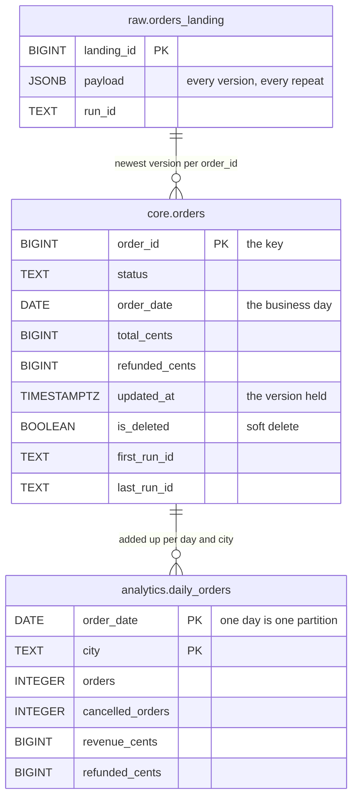
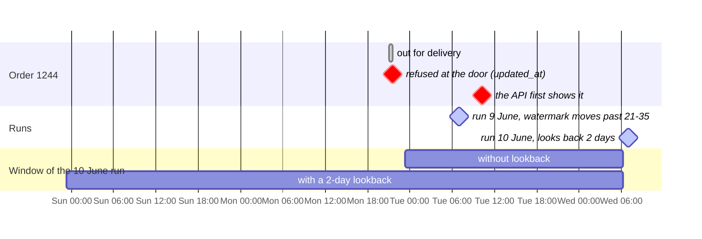

# LLD: Milestone 3, Safe to run twice

**Status:** Final; built
**Fits inside:** [HLD](HLD.md)

> **What this document is.** A low-level design (LLD) gives the exact detail of each part named in the [HLD](HLD.md). Keep it open beside the notebooks and the code. Section 10 says which notebook and which file build each part.

## 1. Files

Everything is inside `src/m3_safe_to_run_twice/`. Nothing imports from another milestone.

```
docs/                     BRD.md, HLD.md, LLD.md
notebooks/                the lab: eight notebooks, run in order
daily_orders/             production code
  config.py               addresses, the retry settings, LOOKBACK_DAYS
  extract.py              changed orders (with retry), and deletes from the change feed
  warehouse.py            the Postgres database and its tables
  load.py                 land raw, stage, MERGE, soft delete, explain, save progress
  report.py               rebuild the report day by day; read it
  pipeline.py             one morning, in one transaction
  flow_data.py            builds the numbers shown on the flow page and the recap page
tests/                    the three properties, and everything else
milestone_3_flow.html     the whole pipeline, animated
milestone_3_recap.html    the closing page
```

## 2. The tables



| Table | Grain | Written by | Pattern |
|---|---|---|---|
| `raw.orders_landing` | One row per landed row | Land | Append |
| `core.orders` | One row per **order** | MERGE, soft delete | Upsert |
| `analytics.daily_orders` | One row per day, per city | Rebuild days | Replace one day |
| `ops.watermarks` | One row per source | Save progress | Upsert |
| `ops.load_runs` | One row per run | The pipeline | Append |
| `ops.report_changes` | One row per order that moved an earlier day | Explain, soft delete | Append |

### Keys

| Word | In this pipeline |
|---|---|
| **Primary key** | The column the database keeps unique: `order_id` in `core.orders` |
| **Natural key** | A key that comes from the business itself: `order_id`, given by the order system |
| **Dedupe key** | The key you keep one row per: `order_id`, in the staging step |

`landing_id` is a different kind of key. The warehouse invented it. It identifies a **landed row**, not an order.

## 3. Stage: one row per order

A run can hold the same order more than once: the API can serve a page twice, and the lookback can bring an old version beside a new one. `MERGE` refuses that. So staging keeps the newest version of each order.

```sql
SELECT DISTINCT ON (order_id) *
FROM   <this run's landed rows, as columns>
ORDER  BY order_id, updated_at DESC, landing_id DESC;
```

On 11 June the API serves one page twice, and the lookback re-reads two days. 120 rows land. Staging keeps 95, one per order.

## 4. The MERGE

```sql
MERGE INTO core.orders AS t
USING stage_orders AS s
   ON t.order_id = s.order_id
WHEN MATCHED AND s.updated_at > t.updated_at THEN      -- a newer version: update the row
    UPDATE SET status = s.status, item_count = s.item_count,
               total_cents = s.total_cents, refunded_cents = s.refunded_cents,
               updated_at = s.updated_at, last_run_id = :run_id
WHEN NOT MATCHED THEN                                   -- a new order: insert a row
    INSERT (...) VALUES (...);
```

Three things can happen to an incoming row:

| The incoming order | Rule that fires | Result |
|---|---|---|
| Is not in the table | `NOT MATCHED` | Inserted |
| Is in the table, and this version is newer | `MATCHED AND newer` | Updated |
| Is in the table, with the same or an older version | none | **Left alone** |

The third row is what makes a second run harmless.

Order 1130 across two mornings:

| After run | Rows in `raw.orders_landing` | Row in `core.orders` |
|---|---|---|
| `2026-06-08_1` | 1 (refunded 0) | total 1475, refunded 0 |
| `2026-06-09_1` | 2 (refunded 0, refunded 578) | total 1475, refunded **578** |
| `2026-06-09_2` | 3 | total 1475, refunded 578: unchanged |

## 5. The lookback

```python
since = watermark - timedelta(days=LOOKBACK_DAYS)  # LOOKBACK_DAYS = 2
```



The cancellation has an `updated_at` of Monday 21:35. The API first showed it on Tuesday at 10:15, after Tuesday's run. By then the watermark was already past Monday 21:35.

| Run of 10 June | Asks for orders changed since | Reads order 1244's cancellation? |
|---|---|---|
| Without lookback | `2026-06-09T04:17:31Z` | No. For ever |
| With a 2-day lookback | `2026-06-07T04:17:31Z` | Yes |

## 6. Deletes

A deleted order has no row, so it has no `updated_at`. The query can never return it. The pipeline reads the order system's **change feed** and keeps the deletes.

```sql
UPDATE core.orders AS t
   SET is_deleted = true, deleted_at = d.deleted_at, last_run_id = :run_id
  FROM <the deletes> AS d
 WHERE t.order_id = d.order_id AND NOT t.is_deleted;     -- marking twice changes nothing
```

| | Hard delete | Soft delete (chosen) |
|---|---|---|
| What happens to the row | Removed for good | Kept, with `is_deleted = true` |
| Can you say later what was deleted? | No | Yes |
| What readers must do | Nothing | Skip deleted rows |

The change feed is a stand-in. In a real company this list comes from the source database's own log, through a tool such as Debezium. That is **log-based CDC**.

## 7. Rebuild days: replace one day

```sql
BEGIN;
DELETE FROM analytics.daily_orders WHERE order_date = ANY(:days);

INSERT INTO analytics.daily_orders
SELECT order_date, city, count(*) FILTER (WHERE status <> 'cancelled'), ...
FROM core.orders
WHERE order_date = ANY(:days) AND NOT is_deleted
GROUP BY order_date, city;
COMMIT;
```

`:days` are the business days of the orders this run touched. Use the same days in the `DELETE` and in the `INSERT`.

To fix one day by hand:

```sh
uv run python -m daily_orders --rebuild-day 2026-06-05
```

## 8. Checks

| Property | The test |
|---|---|
| Run it twice and nothing changes | `test_running_the_same_morning_twice_changes_nothing`, `test_five_runs_in_a_row_equal_one` |
| Re-run an old day and that day is corrected | `test_rebuilding_one_day_corrects_it_and_touches_no_other` |
| An order cancelled later lowers the old day's total | `test_an_order_cancelled_later_lowers_the_old_days_total` |
| The report equals the answer key on every morning, 2 to 18 June | `test_the_report_equals_the_answer_key_on_every_morning` |
| A repeated page changes nothing | `test_fixed_a_repeated_page_changes_nothing` |
| The late update is caught, and missed without a lookback | `test_fixed_the_late_update_is_caught_by_the_lookback`, `test_without_a_lookback_...` |
| A deleted order is marked, kept and not counted | `test_fixed_a_deleted_order_is_marked_and_not_counted` |
| A crash in the middle saves nothing | `test_a_crash_in_the_middle_saves_nothing_and_the_next_run_recovers` |
| Without the dedupe step, `MERGE` refuses a repeated page | `test_without_the_dedupe_step_merge_refuses_the_repeated_page` |

All are in `tests/test_pipeline.py` and `tests/test_load.py`.

## 9. What is still wrong

The numbers are right. The way they are made is not.

| Problem | What it looks like here |
|---|---|
| All the logic is in one script | The report's rules are SQL inside Python strings in `load.py` and `report.py`. A person who knows SQL but not Python cannot change them |
| Nothing checks the tables | The tests prove the **code** on test data. Nothing looks at the tables after this morning's real run |
| Nobody knows when the number is wrong | If the order system sent a negative total tomorrow, the report would add it up and say nothing |

**All the logic is in one script. Nothing checks the tables. Nobody knows when the number is wrong.** Milestone 4 moves the SQL into models and puts tests on the tables.

## 10. Where each part is built

| Notebook | Teaches | Design sections | Code |
|---|---|---|---|
| `01_one_order_one_row` | Upsert, MERGE (against append and overwrite) | HLD 1, 2; LLD 4 | `load.py` |
| `02_which_column_is_the_key` | Primary key, natural key, dedupe key | LLD 2, 3 | `load.py` |
| `03_run_it_twice` | Idempotent, safe re-run | BRD 6; HLD 5 | `pipeline.py` |
| `04_at_least_once_exactly_once` | At-most-once, at-least-once, exactly-once | HLD 3 | |
| `05_the_update_that_came_late` | Late row, lookback | HLD 6; LLD 5 | `pipeline.py` |
| `06_fix_one_day` | Partition, reprocessing one day | LLD 7 | `report.py` |
| `07_the_order_that_vanished` | Hard delete, soft delete, log-based CDC | LLD 6 | `extract.py`, `load.py` |
| `08_the_production_version` | The three properties as tests | LLD 1, 8, 9 | `tests/` |
