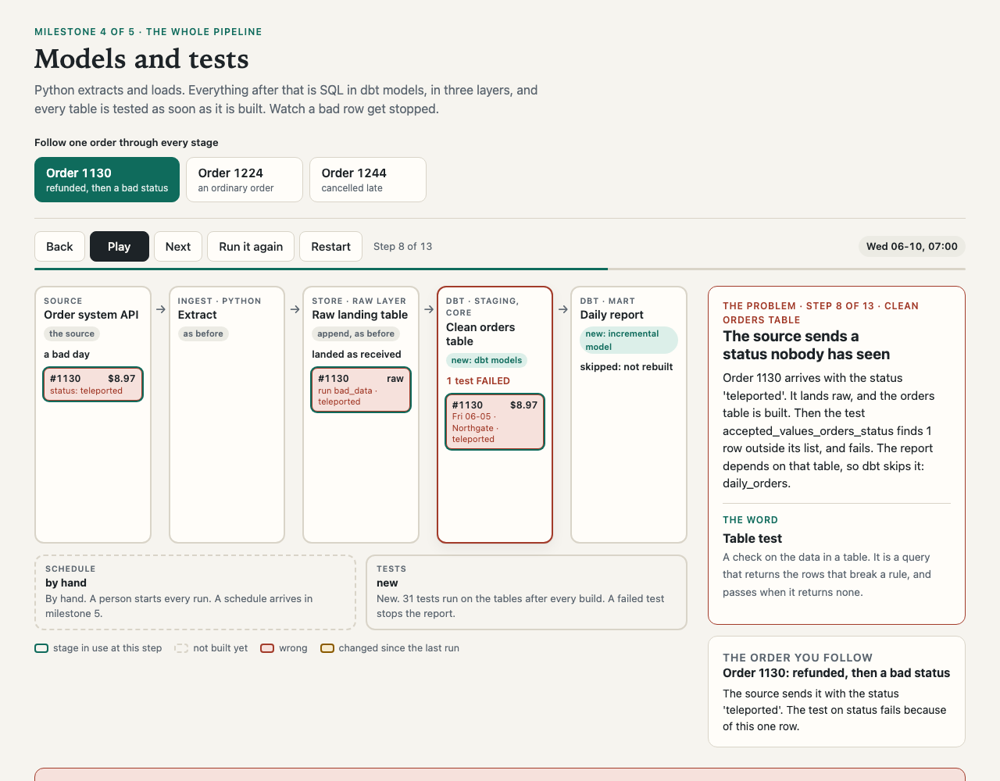

# Milestone 4: Models and tests

**Status:** Done. Design documents, lab notebooks, production code, the dbt project, tests, flow page and recap page are complete.

This folder is self-contained. Nothing in it imports from another milestone.



## Why this milestone exists

After milestone 3 the numbers were right. But every rule of the report was SQL inside a Python string, in one script. And nothing checked the tables after a run.

**What you build:** Python now only extracts and loads. A **dbt** project does the rest: staging models that clean and deduplicate, a clean `orders` and `order_items`, and the `daily_orders` report as an incremental model. Table tests run on every build, and a freshness check watches the raw data.

**The outcome:** the same report as milestone 3, on every morning from 2 to 18 June. When the source sends a status nobody has seen, the run fails, names the test, and the report keeps its last good numbers.

## The numbers

| Notebooks | pytest tests | dbt models and seeds | Tests on the tables | Orders after two mornings | New words |
|---|---|---|---|---|---|
| 7 | 31 | 7 | 31 | 251 | 13 |

## Read it in this order

1. **[milestone_4_flow.html](milestone_4_flow.html)**: open it in a browser first.
2. [docs/BRD.md](docs/BRD.md): what the business needs and why.
3. [docs/HLD.md](docs/HLD.md): the parts, the three layers, and what a failed test does.
4. [docs/LLD.md](docs/LLD.md): the models, the tests and the freshness check.
5. The notebooks in `notebooks/`, from `01` to `07`.
6. The SQL in `dbt_project/`, then the Python in `daily_orders/` and `tests/`.
7. **[milestone_4_flow.html](milestone_4_flow.html)** again.
8. [milestone_4_recap.html](milestone_4_recap.html): a look back.

## What is in this folder

| Folder | Holds |
|---|---|
| [docs/](docs/) | [BRD](docs/BRD.md), [HLD](docs/HLD.md) and [LLD](docs/LLD.md), each with diagrams |
| `notebooks/` | The lab: seven notebooks, run in order |
| `daily_orders/` | Python: extract, load, and running dbt |
| `dbt_project/` | SQL: every transformation, and every table test |
| `tests/` | pytest: the pipeline, and that the table tests fail when they should |

```
dbt_project/models/
  sources.yml            the raw tables, and the freshness check
  staging/               stg_orders, stg_order_items, stg_order_deletes   (views)
  core/                  orders, order_items                              (tables)
  marts/                 daily_orders                                     (incremental)
```

## Set up: dbt is new, and uv installs it

Nothing to install by hand. The commands are the same on macOS, Linux and Windows. From the project folder:

```sh
uv sync                          # installs dbt-core 1.12 and dbt-postgres 1.11 into .venv
docker compose up -d warehouse   # Postgres 16 on port 5440
uv run python -m order_system    # the order system; leave it running
```

## Shut it down

| You started | Stop it with |
|---|---|
| The order system, `uv run python -m order_system` | **Ctrl+C** in its terminal |
| The warehouse, `docker compose up -d warehouse` | `docker compose down`, from the project folder |

`docker compose down` keeps the warehouse data. Add `-v` to delete it too.

## The lab

Open the notebooks in VS Code, choose the project's `.venv` as the kernel, and run them in order. The order system and the warehouse must be running.

| Notebook | What you do | New words |
|---|---|---|
| `01_load_first_transform_later` | Python stops transforming. Compare ELT with milestone 1's ETL | ELT |
| `02_your_first_model` | Write one SELECT in a file, and let dbt build it | Model, type casting, cleaning |
| `03_clean_join_enrich` | One row per order again, then two joins and their traps | Deduplication, join, enrichment |
| `04_a_loop_or_a_set` | Answer one question row by row, then with one statement | Row-by-row, set-based |
| `05_layers_and_the_incremental_model` | Three layers, and a report that rebuilds only its newest days | Staging, core, mart. Incremental model |
| `06_tests_on_the_tables` | Break the data on purpose, and watch the pipeline refuse it | Table test, freshness |
| `07_the_production_version` | One morning as ELT: Python loads, dbt transforms and tests | |

## Run the program

In a second terminal, from this folder:

```sh
uv run python -m order_system.clock --morning 2026-06-08
uv run python -m daily_orders                 # extract, load, then dbt build
uv run python -m order_system.clock --advance-days 1
uv run python -m daily_orders                 # Friday moves, with a reason; 31 tests pass
```

Two more commands:

```sh
uv run python -m daily_orders --freshness     # is the raw data recent?
uv run python -m daily_orders --full-refresh  # rebuild every day of the report
```

It writes to the database `arden_m4`.

## Use dbt directly

An analyst does not need the Python at all. From `dbt_project/`:

```sh
uv run dbt build --profiles-dir .                  # build every model, run every test
uv run dbt test --select orders --profiles-dir .   # only the tests of one table
uv run dbt source freshness --profiles-dir .       # is the raw data recent?
uv run dbt docs generate --profiles-dir .          # a browsable catalogue of the models
```

## Run the tests

```sh
uv run pytest
```

It takes over a minute, because it runs dbt many times. The warehouse must be running.

| Kind of test | Where | It checks | Runs |
|---|---|---|---|
| Table tests | `dbt_project/` | The **data** of this morning | On every pipeline run |
| pytest | `tests/` | The **code**, and that the table tests fail when they should | When the code changes |

## The pages show real numbers

```sh
uv run python -m daily_orders.flow_data
```

## Five things you learn

1. Load raw first, transform in the warehouse.
2. Clean once, in staging. Then shape. Then add up.
3. Count rows before and after every join.
4. Test the tables, not only the code.
5. An old right number beats a new wrong one.

## New words

| Word | Meaning |
|---|---|
| **ELT** | Load the raw data, then transform it inside the warehouse |
| **Model** | One SELECT in a file. dbt builds a table or a view from it |
| **Type casting**, **cleaning** | Give each value its real type, and one spelling |
| **Deduplication** | Keep one row per key: the newest |
| **Join**, **enrichment** | Put two tables side by side where a key matches. Add columns from another table |
| **Row-by-row**, **set-based** | Visit one row at a time. Or say what you want from all the rows together |
| **Staging, core, mart** | Three layers: clean it, one row per real thing, what people read |
| **Incremental model** | A model that rebuilds only part of its table |
| **Table test** | A query that returns the rows that break a rule. No rows means a pass |
| **Freshness** | Is the newest loaded row recent enough? |

Each word has an interview line in the project's [GLOSSARY.md](../../GLOSSARY.md).

## Still wrong

> A person must remember to run it every morning.

Milestone 5 puts the pipeline on a schedule.
