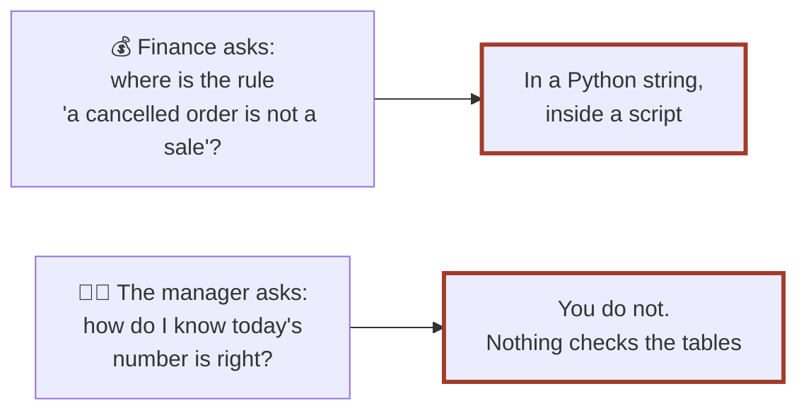

# BRD: Milestone 4, Models and tests

**Status:** Final; built
**Milestone:** 4 of 5 (see the project [README](../../../README.md#milestones))

> **What this document is.** A business requirements document (BRD) says what the business needs and why, in business words. Read it first. Next, read the [HLD](HLD.md) to see what gets built.

## 1. The business problem

After milestone 3 the report is right on every morning. But two questions have no good answer.

This is the third thing that went wrong at Arden: **old days were silently wrong.** Nobody knew, because nothing looked.

## 2. What the business needs

| # | Need | Why |
|---|---|---|
| 1 | Every rule of the report is written where an analyst can read it and change it | A rule is business knowledge. It must not hide inside program code |
| 2 | The tables are checked after every run | A wrong number must be found by the pipeline, not by the manager |
| 3 | If a check fails, the report keeps its last good numbers | An old right number is better than a new wrong one |
| 4 | Someone is told when the data is too old | A report that silently shows last week's numbers is also wrong |
| 5 | A new question can be answered from the warehouse | Without a programmer, and without asking the order system again |

## 3. The people

| Person | What they need from this milestone |
|---|---|
| 👩‍💼 Operations manager | A report that is checked before she sees it |
| 💰 Finance | The rules, in SQL they can read |
| 🏙️ City managers | A table of order items, for questions about products |
| 🎓 Learner | The same numbers as milestone 3, made in a way a team can maintain |

## 4. The rules, now written as checks

Every business rule from milestones 1 to 3 becomes a test on a table.

| Rule | The check |
|---|---|
| One order is one row | `order_id` is unique, and never empty |
| An order has one of five statuses | `status` is one of: placed, packed, out_for_delivery, delivered, cancelled |
| Every order belongs to one of Arden's cities | `city` is one of the three known cities |
| Every item belongs to an order | Each `order_id` in the items table exists in the orders table |
| An order's total is the sum of its items | The total equals the item lines that were not out of stock |
| Money is never negative | No negative total, no refund larger than the total |
| The report is the sum of its orders | Each day's total in the report equals the same day added up from the orders |
| One row per day and city | No day and city appears twice in the report |
| The data is recent | The newest loaded row is less than 24 hours old |

## 5. Scope

**In scope:** the transformations as SQL models in three layers, an orders table and an order-items table, the report as an incremental model, tests on the tables, and a freshness check.

**Out of scope for this milestone:**

| Not yet | Arrives in |
|---|---|
| A schedule | Milestone 5 |
| Alerts to a person's phone, a dashboard | Other projects of the series |

## 6. Success criteria

- The report still equals the answer key on every morning from 2 to 18 June.
- The three properties of milestone 3 still hold: safe to run twice, a later cancel lowers the old day, every change is explained.
- When the order system sends a status nobody has seen, the run **fails**, names the check that failed, and the report keeps its last good numbers.
- The clean tables can be dropped and rebuilt from the raw data alone, with no call to the order system.
- "Which product sold the most units on Sunday?" is one SQL query.

## 7. Assumptions

- All data is fictional and generated.
- The team can read SQL. The models are written for them.
