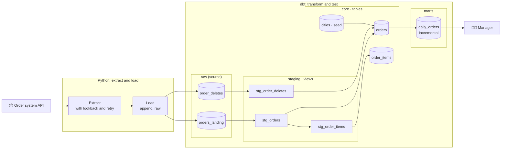
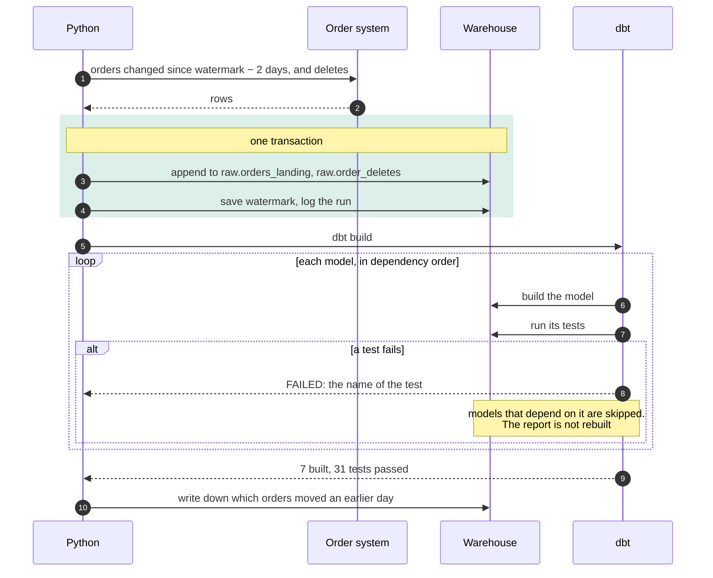
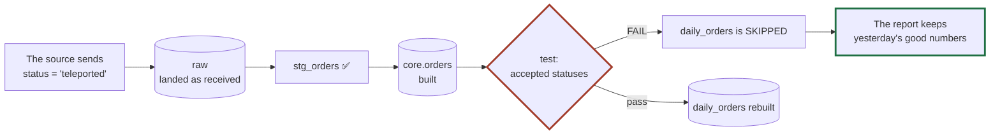

# HLD: Milestone 4, Models and tests

**Status:** Final; built
**Satisfies:** [BRD](BRD.md)

> **What this document is.** A high-level design (HLD) names the parts of the system, what each part does, and how data moves between them. Read it after the [BRD](BRD.md). The [LLD](LLD.md) then gives the exact detail.

## 1. The approach in one picture

Python does two things only: **extract** and **load**. It lands what arrived, exactly as it arrived. Every transformation after that is a SQL model in a **dbt** project, and dbt tests each table as soon as it is built.

The order of the letters changed. Milestone 1 was **ETL**: transform in Python, then load the result. This is **ELT**: load the raw data, then transform it inside the warehouse.

## 2. What changed since milestone 3

| Part | Milestone 3 | Milestone 4 |
|---|---|---|
| Where the transform is written | SQL inside Python strings | One `.sql` file per table (**model**) |
| Who can change a rule | A programmer | Anyone who reads SQL |
| The clean orders table | Kept up to date with `MERGE` | Rebuilt from raw on every run |
| The order items | Dropped | A table of their own |
| The report | Rebuilt for the days a run touched | An **incremental model**: rebuilds the newest days |
| Checks on the data | None | **Table tests**, run after each table is built |
| When a check fails | Does not apply | The run fails. The report keeps its last good numbers |
| Old data | Nobody notices | A **freshness** check |

## 3. Three layers

A layer is a set of tables at one level of cleaning. Each layer has one job.

| Layer | Its job | Here | Built as |
|---|---|---|---|
| **raw** | Keep what arrived, exactly | `orders_landing`, `order_deletes` | Tables. Python appends |
| **staging** | Clean it: types, one spelling, one row per key | `stg_orders`, `stg_order_items`, `stg_order_deletes` | Views |
| **core** | One row per real thing | `orders`, `order_items`, `cities` | Tables |
| **marts** | What people read | `daily_orders` | Incremental table |

Other teams call the same idea bronze, silver and gold: raw is bronze, the cleaned tables are silver, and the business-ready tables are gold. The names are a habit, not a rule.

The rule that matters: **clean first, then shape, then add up.** Each layer reads only from the layer before it.

## 4. One morning, step by step

## 5. What a failed test does

The bad row is still in the raw table. Nothing was lost. When the source is fixed, the next run reads the right version, and everything builds.

## 6. Key design decisions

| Decision | Reason |
|---|---|
| **ELT**, with dbt | The raw data is in the warehouse already. SQL is what the warehouse is good at, and what the team can read |
| Staging models are **views** | A view is always up to date and stores nothing. The data is small |
| `orders` and `order_items` are rebuilt on every run | 432 orders build in well under a second. Rebuilding from raw is the simplest correct thing |
| `daily_orders` is **incremental**, with `delete+insert` by day | It is milestone 3's "replace one day", now a setting. Each run deletes the newest days and inserts them again |
| The incremental window is 7 days | The latest change so far came 3 days after the order. Older days are not touched. `--full-refresh` rebuilds everything |
| Deduplication is in staging | Every model after it can trust: one row per order |
| Deletes are landed raw, then joined in | Python no longer changes a clean table. The soft-delete flag is worked out in SQL |
| `dbt build`, not `run` then `test` | A model is tested as soon as it is built, and what depends on a failed test is skipped |
| Set-based SQL, never a loop over rows | One statement for all rows. The warehouse does the work |

### Which incremental strategy

The Postgres adapter of dbt supports four strategies. Checked against dbt-postgres 1.11.

| Strategy | What it does | Used here? |
|---|---|---|
| `append` | Inserts the new rows. Never touches old ones | No. It is milestone 2's mistake |
| `delete+insert` | Deletes the rows with a matching key, then inserts | **Yes**, with the business day as the key |
| `merge` | A `MERGE` on the key. Needs Postgres 15 or later | No. It would leave a city's row behind if a day lost its last order in that city |
| `microbatch` | Splits the work into time batches by an event-time column | No. One window is enough here |

## 7. What this design costs

| Cost | What happens | Fixed in |
|---|---|---|
| A person must remember to run it | No report on the day they forget, and no report before they wake up | Milestone 5 |
| A change older than 7 days does not reach the report by itself | The test "the report equals its orders" fails and says so. `--full-refresh` repairs it | Accepted |
| One more tool to learn | dbt has its own words: model, ref, source, seed | Accepted |

## 8. Technology

Python 3.12, `httpx`, Postgres 16, `psycopg` 3, **dbt-core 1.12 with dbt-postgres 1.11**, pytest. dbt is installed by `uv sync` into the project's virtual environment. Nothing else to install.

## 9. Risks

| Risk | Handling |
|---|---|
| A test is too strict and blocks a good report | The failure names the test and the rows. A person decides. Never turn a test off just to make a run pass |
| A test that never runs raises no alarm | `dbt build` runs every test on every run, and the run log stores how many passed |
| The freshness check uses load time, and the lab's clock is pretend | The check compares real load times with the real clock. It is honest in the lab too |
