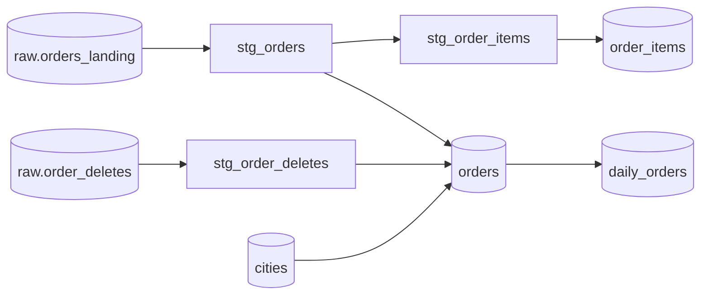

# LLD: Milestone 4, Models and tests

**Status:** Final; built
**Fits inside:** [HLD](HLD.md)

> **What this document is.** A low-level design (LLD) gives the exact detail of each part named in the [HLD](HLD.md). Keep it open beside the notebooks and the code. Section 10 says which notebook and which file build each part.

## 1. Files

Everything is inside `src/m4_models_and_tests/`. Nothing imports from another milestone.

```
docs/                       BRD.md, HLD.md, LLD.md
notebooks/                  the lab: seven notebooks, run in order
daily_orders/               Python: extract and load, and running dbt
  extract.py                changed orders (with retry), and deletes from the change feed
  warehouse.py              the raw and ops tables
  load.py                   land raw; save the watermark
  transform.py              run dbt, and sum up what it did
  report.py                 read the report; explain what changed
  pipeline.py               one morning: extract, load, then dbt build
  flow_data.py              builds the numbers shown on the pages
dbt_project/                SQL: every transformation, and every table test
  dbt_project.yml           the layers, and their settings
  profiles.yml              how dbt reaches the warehouse
  models/sources.yml        the raw tables, and the freshness check
  models/staging/           stg_orders, stg_order_items, stg_order_deletes
  models/core/              orders, order_items
  models/marts/             daily_orders
  seeds/cities.csv          Arden's three cities
  tests/                    three tests written as SQL
  macros/                   a schema-name rule, and one test of our own
tests/                      pytest: the pipeline, and that the table tests fail when they should
```

## 2. A model

A **model** is one `SELECT` in a file. dbt builds a table or a view from it. A model never says `CREATE TABLE` or `INSERT`.

```sql
-- models/core/order_items.sql
select
    i.order_id,
    i.line_no,
    i.product_name,
    i.quantity,
    i.unit_price_cents,
    case when i.item_status = 'ok' then i.quantity * i.unit_price_cents else 0 end as line_total_cents
from {{ ref('stg_order_items') }} as i
```

| Piece | Meaning |
|---|---|
| `{{ ref('stg_order_items') }}` | "The model called `stg_order_items`." dbt fills in the real table name, and learns that this model must be built after that one |
| `{{ source('raw', 'orders_landing') }}` | A table dbt did not build: the raw landing table |
| `{{ var('business_time_zone') }}` | A setting from `dbt_project.yml` |

From the `ref` calls dbt works out the order to build in:



## 3. Staging: clean, cast, deduplicate (`stg_orders.sql`)

Three jobs, in three steps.

| Step | Job | In the SQL |
|---|---|---|
| `typed` | **Type casting**: every value out of the JSON gets its real type | `(payload->>'total_cents')::bigint` |
| `typed` | **Cleaning**: one spelling for each value | `lower(trim(payload->>'status'))`, `upper(trim(payload->>'city'))` |
| `ranked` | **Deduplication**: number the versions of each order, newest first, and keep number 1 | `row_number() over (partition by order_id order by updated_at desc, landing_id desc)` |

Rows in, rows out, after the runs of 8 and 9 June:

| Table | Rows | Grain |
|---|---|---|
| `raw.orders_landing` | 328 | One landed row |
| `staging.stg_orders` | 251 | One order |
| `staging.stg_order_items` | 842 | One item line |

## 4. Core: join and enrich (`orders.sql`)

```sql
from {{ ref('stg_orders') }} as o
left join {{ ref('cities') }} as c on c.city = o.city                      -- enrichment
left join {{ ref('stg_order_deletes') }} as d on d.order_id = o.order_id   -- soft delete
```

| Column added | From | The word |
|---|---|---|
| `city_name` | The `cities` seed | **Enrichment**: adding columns from another table |
| `is_deleted`, `deleted_at` | `stg_order_deletes` | The soft delete of milestone 3, now worked out in SQL |
| `net_cents` | `total_cents - refunded_cents` | A value defined once, used by every model after it |

Both joins are **left joins**. An order in a city the seed does not know must stay in the table. Then a test can find it. An inner join would drop it with no error.

## 5. Mart: the incremental model (`daily_orders.sql`)

```sql
{{ config(materialized='incremental', incremental_strategy='delete+insert', unique_key='order_date') }}

select order_date, city, city_name, count(*) filter (...) as orders, ...
from {{ ref('orders') }}
where not is_deleted

  and order_date >= (select max(order_date) from {{ this }}) - {{ var('reprocess_days') }}

group by order_date, city, city_name
```

| Run | `is_incremental()` | What dbt does |
|---|---|---|
| The first run, or `--full-refresh` | false | Builds every day |
| Every later run | true | Works out the days from 7 days before the report's newest day. Deletes those days from the table. Inserts them again |

It is milestone 3's "replace one day", written as three settings. Measured on the run of 16 June: the report holds 14 days, and the run rebuilds the last 8 of them.

## 6. Table tests

A test is a query that looks for **rows that break a rule**. It passes when it finds none.

### Tests named in a YAML file

```yaml
- name: status
  tests:
    - not_null
    - accepted_values:
        arguments:
          values: [placed, packed, out_for_delivery, delivered, cancelled]
```

| Test | It checks | On |
|---|---|---|
| `unique` | No value appears twice | `orders.order_id`, `stg_orders.order_id`, `cities.city` |
| `not_null` | No value is missing | Keys, status, city, the money columns |
| `accepted_values` | Only the listed values | `orders.status`, `order_items.item_status` |
| `relationships` | Every value exists in another table | Every item's `order_id` is in `orders`. Every order's `city` is in `cities` |

### Tests written as SQL

| File | It returns a row for |
|---|---|
| `assert_report_equals_its_orders.sql` | Each day where the report's total differs from the orders added up |
| `assert_order_total_equals_its_items.sql` | Each order whose total differs from its item lines |
| `assert_money_is_never_negative.sql` | Each order with a negative total, or a refund larger than its total |

One more is a test of our own, in `macros/`: `one_row_per_day_and_city`.

Every run executes **31** tests.

## 7. Freshness

```yaml
sources:
  - name: raw
    loaded_at_field: loaded_at
    freshness:
      warn_after:  {count: 24, period: hour}
      error_after: {count: 48, period: hour}
```

`dbt source freshness` compares the newest `loaded_at` in `raw.orders_landing` with the clock.

| The newest row is | Result |
|---|---|
| Less than 24 hours old | pass |
| 24 to 48 hours old | warn |
| More than 48 hours old | error |

```sh
uv run python -m daily_orders --freshness
```

## 8. Checks on the pipeline itself (pytest)

| Check | Test |
|---|---|
| The report equals the answer key on every morning, 2 to 18 June | `test_the_report_equals_the_answer_key_on_every_morning` |
| Running a morning twice changes nothing | `test_running_the_same_morning_twice_changes_nothing` |
| An unknown status fails the run, and names the test | `test_an_unknown_status_fails_the_accepted_values_test` |
| When a test fails, the report keeps its last good numbers | `test_when_a_test_fails_the_report_keeps_its_last_good_numbers` |
| The incremental report equals a full rebuild | `test_the_incremental_report_equals_a_full_rebuild` |
| An incremental run touches only recent days | `test_an_incremental_run_touches_only_recent_days` |
| The clean tables can be rebuilt from raw alone | `test_the_clean_tables_can_be_rebuilt_from_raw_alone` |
| Old data fails the freshness check | `test_fresh_data_passes_and_old_data_fails_the_freshness_check` |

## 9. What is still wrong

Everything is right, and everything is checked. One thing is left.

| Morning | What must happen | Who does it |
|---|---|---|
| Every day at 07:00 | `uv run python -m daily_orders` | A person |
| When the order system is down at 07:00 | Try again a little later | A person, if they notice |
| When a week was missed | Run each missed day | A person, seven times |

**A person must remember to run it every morning.** Milestone 5 puts it on a schedule.

## 10. Where each part is built

| Notebook | Teaches | Design sections | Code |
|---|---|---|---|
| `01_load_first_transform_later` | ELT, against milestone 1's ETL | HLD 1, 2 | `load.py`, `pipeline.py` |
| `02_your_first_model` | Model, cleaning, type casting | LLD 2, 3 | `models/staging/` |
| `03_clean_join_enrich` | Deduplication, join, enrichment | LLD 3, 4 | `models/core/` |
| `04_a_loop_or_a_set` | Row-by-row, set-based | HLD 6 | |
| `05_layers_and_the_incremental_model` | Staging, core, mart. Incremental model | HLD 3; LLD 5 | `models/marts/` |
| `06_tests_on_the_tables` | Table test, freshness | HLD 5; LLD 6, 7 | `models/*.yml`, `tests/` |
| `07_the_production_version` | The pipeline as ELT | LLD 1, 8, 9 | `transform.py`, `tests/` |
