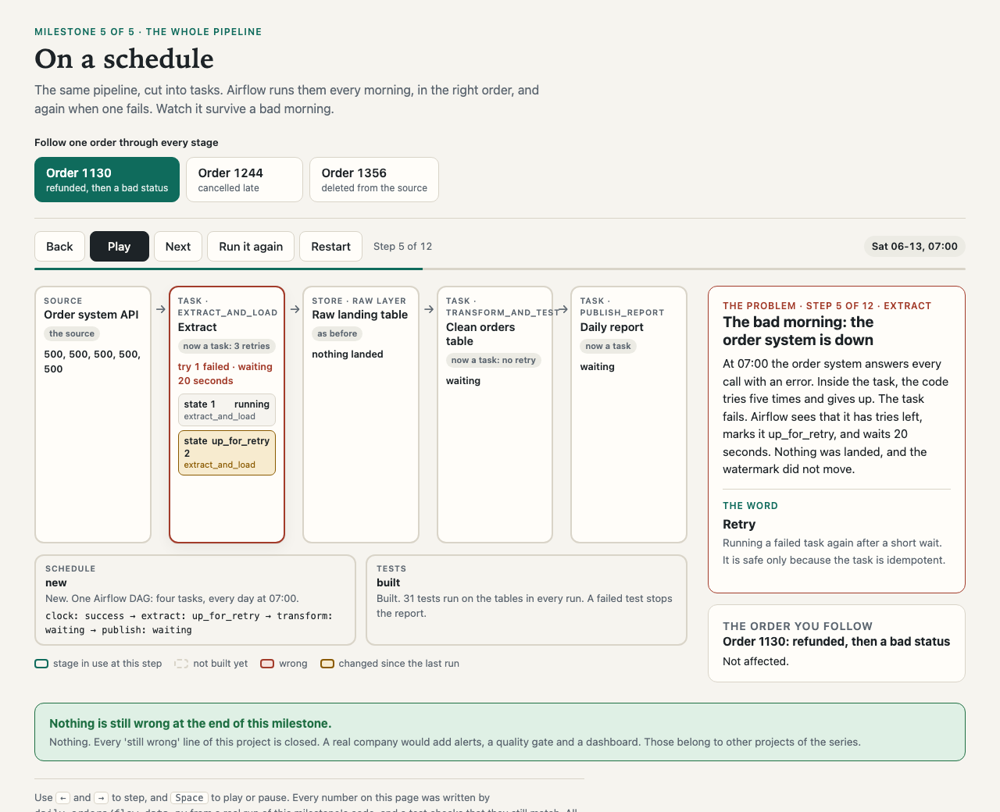

# Milestone 5: On a schedule

**Status:** Done. Design documents, lab notebooks, the DAG, production code, tests, flow page and recap page are complete.

This folder is self-contained. Nothing in it imports from another milestone.



## Why this milestone exists

The pipeline was right, safe to repeat and checked. And every run started with a person typing a command.

**What you build:** one Apache Airflow DAG with four tasks: set the source's clock, extract and load, transform and test, publish the report. It runs daily at 07:00, retries a failed API call, never loads half a day, and can backfill any range of past days with one command.

**The outcome:** the bad morning drill passes. The order system is down at 07:00, then one page is sent twice. The pipeline recovers by itself, and the report is still right.

## The numbers

| Notebooks | pytest tests | Tasks in the DAG | Table tests in every run | New words |
|---|---|---|---|---|
| 7 | 41 | 4 | 31 | 14 |

## Read it in this order

1. **[milestone_5_flow.html](milestone_5_flow.html)**: open it in a browser first.
2. [docs/BRD.md](docs/BRD.md): what the business needs and why.
3. [docs/HLD.md](docs/HLD.md): the DAG, the logical date, and what happens when a task fails.
4. [docs/LLD.md](docs/LLD.md): the containers, the DAG settings, the commands and the drill.
5. The notebooks in `notebooks/`, from `01` to `07`.
6. [dags/daily_orders_dag.py](dags/daily_orders_dag.py), then `daily_orders/` and `tests/`.
7. **[milestone_5_flow.html](milestone_5_flow.html)** again.
8. [milestone_5_recap.html](milestone_5_recap.html): a look back at the milestone and the project.

## What is in this folder

| Folder or file | Holds |
|---|---|
| [docs/](docs/) | [BRD](docs/BRD.md), [HLD](docs/HLD.md) and [LLD](docs/LLD.md), each with diagrams |
| `notebooks/` | The lab: seven notebooks, run in order |
| `dags/` | The DAG, and a second small DAG for the micro-batch lab |
| `daily_orders/` | The pipeline, as steps: `extract-load`, `transform-test`, `report` |
| `dbt_project/` | The same models and table tests as milestone 4 |
| `airflow_tools.py` | Drive Airflow from Python: backfill, replay, trigger, wait |
| `tests/` | The steps without Airflow, and the real DAG on the real Airflow |

## Set up: Airflow is new, and it runs in Docker

Nothing to install by hand. You need Docker with at least 4 GB of memory. The first build downloads about 3 GB and takes several minutes.

**Stop the order system first** if it is still running in a terminal from earlier milestones. In this milestone it runs in Docker, on the same port 8010.

The commands are the same on macOS, Linux and Windows. From the project folder:

```sh
docker compose --profile schedule up -d --build
```

This starts three containers:

| Container | What it is | Where |
|---|---|---|
| `arden-warehouse` | Postgres, as before | port 5440 |
| `arden-order-system` | The fake order system | http://127.0.0.1:8010 |
| `arden-airflow` | Airflow 3.4: scheduler and web page | http://localhost:8080 , no password |

## Shut it down

From the project folder:

```sh
docker compose --profile schedule down
```

This stops and removes all three containers. Use this command, with `--profile schedule`: a plain `docker compose down` stops the warehouse only, and leaves Airflow and the order system running.

| To also | Command |
|---|---|
| Check that nothing is left | `docker compose --profile schedule ps` |
| Delete the warehouse data | `docker compose --profile schedule down -v` |
| Free about 3 GB of disk | `docker rmi arden-airflow:3.4.0 apache/airflow:3.4.0` |
| Pause, and keep the containers | `docker compose --profile schedule stop` |

If you switched on the micro-batch lab, it runs every five minutes until Airflow stops. Switch it off with `docker compose exec airflow airflow dags pause orders_every_five_minutes`.

## The lab

Open the notebooks in VS Code, choose the project's `.venv` as the kernel, and run them in order. The three containers must be running.

| Notebook | What you do | New words |
|---|---|---|
| `01_a_clock_is_not_enough` | Start two steps by the clock, and get yesterday's report | Schedule, cron, orchestration |
| `02_tasks_and_arrows` | Read the DAG, and run it once | Task, dependency, DAG |
| `03_which_day_is_this_run_for` | The logical date, the data interval, and a run you trigger by hand | Data interval, logical date, trigger |
| `04_when_a_task_fails` | Break the API, then break the data, and watch what Airflow does | Retry |
| `05_the_days_you_missed` | Run a week with one command. Run one day again | Catchup, backfill, replay |
| `06_every_five_minutes` | A lab: the same pipeline as a micro-batch | Micro-batch |
| `07_the_bad_morning` | The drill: the API is down, then a page comes twice | |

Each notebook starts from a clean state: it forgets the DAG's run history and empties the lab database `arden_m5`. Notebooks 4 to 7 take one to three minutes each.

## Run it from a terminal

Every `airflow` command runs inside the Airflow container. From the project folder:

```sh
docker compose exec airflow airflow dags unpause daily_orders

# Five business days with one command, oldest first, one at a time
docker compose exec airflow airflow backfill create --dag-id daily_orders \
    --from-date 2026-06-07 --to-date 2026-06-12 --max-active-runs 1

docker compose exec airflow airflow dags list-runs daily_orders

# One finished day, again
docker compose exec airflow airflow tasks clear daily_orders -s 2026-06-09 -e 2026-06-10 -y
```

The report, from this folder:

```sh
uv run python -m daily_orders report
```

The pipeline still runs without Airflow, as in milestone 4: `uv run python -m daily_orders`.

## Run the tests

```sh
uv run pytest
```

It takes about seven minutes, because it drives the real Airflow several times. It resets the lab database `arden_m5` and the DAG's run history. For the quick part only:

```sh
uv run pytest tests/test_pipeline.py tests/test_extract.py
```

## The pages show real numbers

```sh
uv run python -m daily_orders.flow_data
```

This drives the real Airflow through a week, the bad morning, a replay and a run with bad data, and writes what happened into the pages. It takes a few minutes.

## Five things you learn

1. A clock cannot say "after". Only a dependency makes one step wait for another.
2. An orchestrator holds no business logic.
3. Use the logical date, never the clock.
4. Retry what time can fix. Stop for what only a person can fix.
5. A scheduler is only as safe as your steps are idempotent.

## New words

| Word | Meaning |
|---|---|
| **Schedule**, **cron** | A schedule starts a run at a time. Cron's five fields are the usual way to write one |
| **Orchestration** | Running the steps in the right order, at the right time, and watching them |
| **Task**, **dependency** | One step of the job. A rule that one task needs another to finish first |
| **DAG** | Directed acyclic graph: the tasks and the arrows between them |
| **Data interval**, **logical date** | The slice of time a run covers. The day a run is for |
| **Trigger** | Starting a run by hand, for a day you name |
| **Retry** | Running a failed task again after a wait |
| **Catchup** | A scheduler running missed days by itself. Off here |
| **Backfill** | Running the job for a range of past days |
| **Replay** | Running a finished day again |
| **Micro-batch** | The same batch, with a very small slice |

Each word has an interview line in the project's [GLOSSARY.md](../../GLOSSARY.md).

## A note on the fake source

The order system in this project is a simulation with a clock a person controls. The DAG's first task, `set_source_clock`, moves that clock to the morning of the run, so that a backfill of last Tuesday sees the source as it was on that morning. A real order system has no such clock, and a real DAG has no such task.

## Nothing is still wrong

Every "still wrong" line of this project is closed. A real company would add alerts, a quality gate and a dashboard. Those belong to other projects of the D8Loop series.
