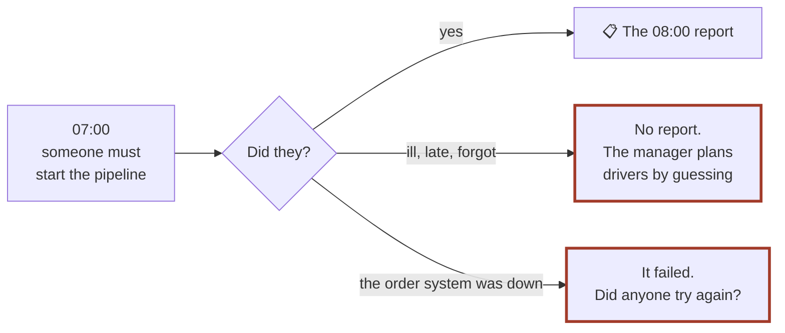

# BRD: Milestone 5, On a schedule

**Status:** Final; built
**Milestone:** 5 of 5 (see the project [README](../../../README.md#milestones))

> **What this document is.** A business requirements document (BRD) says what the business needs and why, in business words. Read it first. Next, read the [HLD](HLD.md) to see what gets built.

## 1. The business problem

The pipeline is right, safe to run twice, and checked. And it only runs when a person types a command.

This is where the project started: a person, a routine, and mornings when it did not happen.

## 2. What the business needs

| # | Need | Why |
|---|---|---|
| 1 | The report is made every morning at 07:00, with nobody starting it | The manager reads it at 08:00 |
| 2 | The steps run in the right order, and a step never starts before the one it needs has finished | A report built before the load is yesterday's report |
| 3 | If the order system is down for a minute, the pipeline tries again by itself | A short outage must not cost a day's report |
| 4 | If the data is wrong, the pipeline stops and does **not** try again | Trying again cannot fix bad data. A person must look |
| 5 | Missed days can be run later, with one command | After an outage of a week, nobody should run seven commands |
| 6 | Any past day can be run again, safely | To check it, or after a fix |
| 7 | Anyone can see what ran, when, and how it ended | "Did the report run today?" must have an answer |

## 3. The people

| Person | What they need from this milestone |
|---|---|
| 👩‍💼 Operations manager | The report at 08:00, every day, without asking anyone |
| 💰 Finance | A way to re-run last Tuesday, and a record that it was done |
| 🧑‍🔧 The person on call | One page that shows every run, and which step failed |
| 🎓 Learner | The finished pipeline, and a drill that proves it survives a bad morning |

## 4. Business rules

| Rule | Decision |
|---|---|
| When | Every day at 07:00 on Arden's clock (`America/Chicago`) |
| Which day a run is for | The business day that just ended. The run of Monday morning is **for Sunday** |
| The order of the steps | Load, then transform and test, then publish the report |
| A failed load | Is tried again, up to 3 more times, 20 seconds apart |
| A failed check on the data | Is not tried again. The report is not published. The last good report stays |
| Two runs at once | Never. One morning at a time |
| A missed day | Is not run by itself. A person asks for it, with one command |

## 5. Scope

**In scope:** one scheduled workflow for the whole pipeline, retries, a backfill for a range of days, a replay of one day, a short lab that runs the same pipeline every five minutes, and the "bad morning" drill.

**Out of scope:** these belong to other projects of the series.

| Not built here | Where it belongs |
|---|---|
| Alerts to a phone or a chat channel | The quality project |
| A quality gate with rules a person approves | The quality project |
| A dashboard on top of the report | The warehouse project |
| Events processed as they arrive | The clickstream project |

## 6. Success criteria

- A range of five past days runs with **one command**, oldest first, one day at a time, and the report equals the answer key.
- **The bad morning drill passes.** The order system is down at 07:00. Then one page is sent twice. The pipeline tries again by itself, finishes, and the report is still right.
- A run whose data fails a table test ends as failed, the report step never runs, and the last good report stays.
- Running a past day again changes nothing.
- Every run is listed, with the day it was for and how it ended.

## 7. Assumptions

- All data is fictional and generated.
- The order system in this project is a fake with a clock a person controls. Each run first moves that clock to its own morning. A real source needs no such step.
- Airflow runs on the learner's laptop, in one container, for learning. A real company runs it on servers that are always on.
