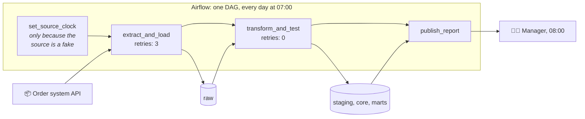
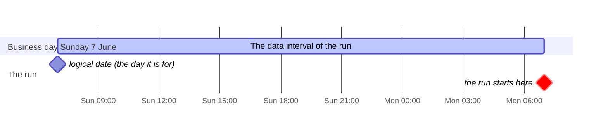
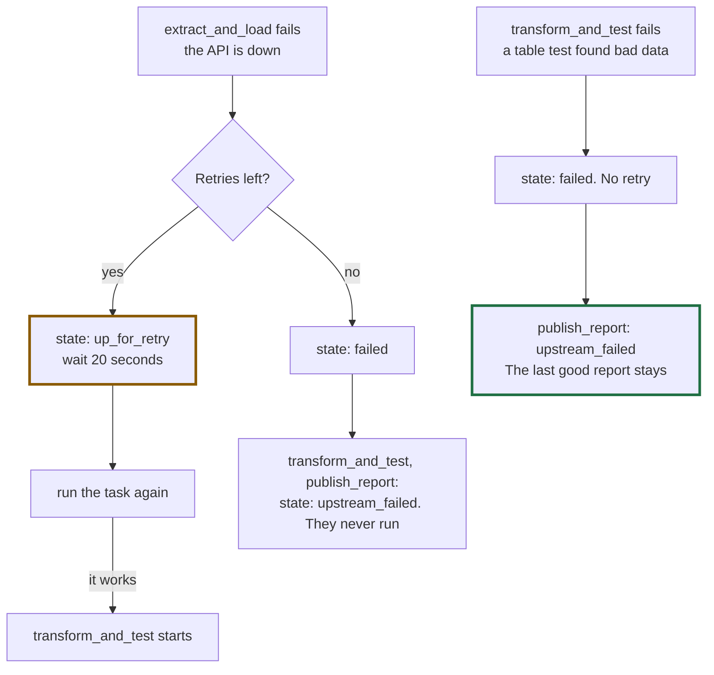

# HLD: Milestone 5, On a schedule

**Status:** Final; built
**Satisfies:** [BRD](BRD.md)

> **What this document is.** A high-level design (HLD) names the parts of the system, what each part does, and how data moves between them. Read it after the [BRD](BRD.md). The [LLD](LLD.md) then gives the exact detail.

## 1. The approach in one picture

Nothing about the data changes in this milestone. The pipeline of milestone 4 is cut into steps, and an **orchestrator**, Apache Airflow, runs the steps: at the right time, in the right order, and again when one fails.



Each box is a **task**. Each arrow is a **dependency**: the task at its head needs the task at its tail to finish first. Tasks and arrows together are a **DAG**.

## 2. What changed since milestone 4

| Part | Milestone 4 | Milestone 5 |
|---|---|---|
| Who starts a run | A person | A **schedule**: every day at 07:00 |
| The order of the steps | One program runs them in a row | Arrows between tasks (**dependencies**) |
| The API is down | The in-code retry gives up after 5 tries, and the run is over | Airflow **retries** the task after a wait |
| Bad data | The run fails | The run fails, the report task is marked `upstream_failed`, and nothing is retried |
| A missed week | Seven commands | One **backfill** |
| A past day again | Run the program by hand | **Replay**: clear the run, and Airflow runs it again |
| What ran? | A table, `ops.load_runs` | A web page with every run and every task, and their logs |
| The transformations, the tests | dbt | The same dbt project. Not one model changed |

## 3. Why a clock is not enough

The simplest schedule is **cron**: a tool that starts a command at a set time.

```
0 7 * * *    python -m daily_orders extract-load
5 7 * * *    python -m daily_orders transform-test
```

| Morning | What happens |
|---|---|
| The load takes 2 minutes | Fine. The transform starts at 07:05 and finds today's rows |
| The load takes 8 minutes | The transform starts at 07:05, finds **yesterday's** rows, passes every test, and publishes yesterday's report |
| The load fails | The transform still starts. Nobody is told |

Cron knows the time. It does not know that one step **needs** another. An orchestrator does.

| Question | Cron | An orchestrator |
|---|---|---|
| Does a step wait for the step before it? | No | Yes |
| Does it try again after a failure? | No | Yes, as often as you say |
| Can you see what ran, and when? | Only if you wrote a log | Yes |
| Can it run last Tuesday again? | By hand | One command |

## 4. Which day is a run for?

A run that starts on Monday at 07:00 is **for Sunday**. Airflow keeps the two apart.



| Word | Meaning | For this run |
|---|---|---|
| **Data interval** | The slice of time a run covers | Sunday 07:00 to Monday 07:00 |
| **Logical date** | The day a run is for. It is the start of the data interval | Sunday 7 June |
| When the run starts | When its data interval is over | Monday 8 June, 07:00 |

The rule from milestone 3, now with its full name: **use the logical date, never the clock.** A run for Sunday must load Sunday's morning whether it happens on Monday at 07:00, on Monday at 11:00 after a retry, or three weeks later in a backfill.

## 5. Three ways a run begins

| Way | Who starts it | Used for |
|---|---|---|
| **Schedule** | Airflow, when a data interval ends | Every normal morning |
| **Trigger** | A person, for one day | A day that has no run yet |
| **Backfill** | A person, for a range of days | Days that were missed |

And one way to do a day **again**: a **replay**. A person clears a finished run, and Airflow runs its tasks again.

What about days the scheduler missed while it was switched off? That is the **catchup** setting.

| `catchup` | When the scheduler comes back after 5 days off | Chosen here |
|---|---|---|
| `True` | It starts all 5 missed runs by itself | No |
| `False` | It starts nothing old. A person asks for a backfill | **Yes** |

With `False`, a person decides when a pile of old runs hits the order system.

## 6. What happens when a task fails



| Task | Retries | Why |
|---|---|---|
| `extract_and_load` | 3, with 20 seconds between | A source that is down often comes back |
| `transform_and_test` | 0 | A test that failed on the data will fail again. Do not retry a check that failed on the data |
| `publish_report` | 0 | It only reads |

A retry is only safe because every step is idempotent. That was milestone 3's work, and this milestone depends on it.

## 7. Key design decisions

| Decision | Reason |
|---|---|
| The tasks run the same program as before: `python -m daily_orders <step>` | Airflow orchestrates. It does not hold business logic. The pipeline still runs without Airflow |
| The pipeline has its own virtual environment inside the image | Airflow and dbt each need many packages, and their versions do not always agree |
| An explicit data-interval timetable | In Airflow 3 a plain cron string gives runs with no data interval. This DAG is about a day of data, so it says so |
| `max_active_runs=1`, and backfills with `--max-active-runs 1` | Two mornings must never write the same tables at the same time |
| `catchup=False` | A person decides when old days run |
| A task that sets the fake source's clock | Only because this source is a simulation. It is drawn apart, and named in the code |
| `airflow standalone`, in one container | The smallest Airflow that works. For learning only |

## 8. The micro-batch lab

A second, small DAG runs the **same pipeline every five minutes**. It is a lab, and it starts switched off.

| | Daily batch | Micro-batch (the lab) | Streaming (not built) |
|---|---|---|---|
| The slice | One day | Five minutes | One event |
| Latency | Up to one day | Up to five minutes, plus the run time | A short moment |
| What you run | This DAG | The same tasks, a different schedule | A different kind of system |

It shows how far a batch can be pushed. Each run is still a normal batch run. Below about a minute, the time a run takes is most of the wait, and a stream becomes the better tool.

## 9. Technology

**Apache Airflow 3.4** in Docker, started with `airflow standalone`. The image is the official `apache/airflow:3.4.0`, with one addition: a virtual environment for the pipeline. Everything else is as in milestone 4: Python, Postgres 16, dbt.

**New to run: one more Docker Compose profile.** `docker compose --profile schedule up -d --build` starts the warehouse, the order system and Airflow. The first build downloads about 3 GB.

## 10. Risks

| Risk | Handling |
|---|---|
| A laptop that is asleep runs nothing | Accepted. This is a lab. `catchup=False` and a backfill cover it |
| The fake source has one clock, and two runs would fight over it | One run at a time. A run that finds the wrong morning stops before it loads |
| Airflow's own database is a file inside the container | Accepted. Removing the container forgets the run history, not the warehouse |
