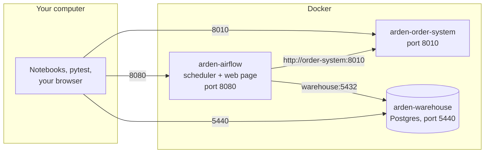
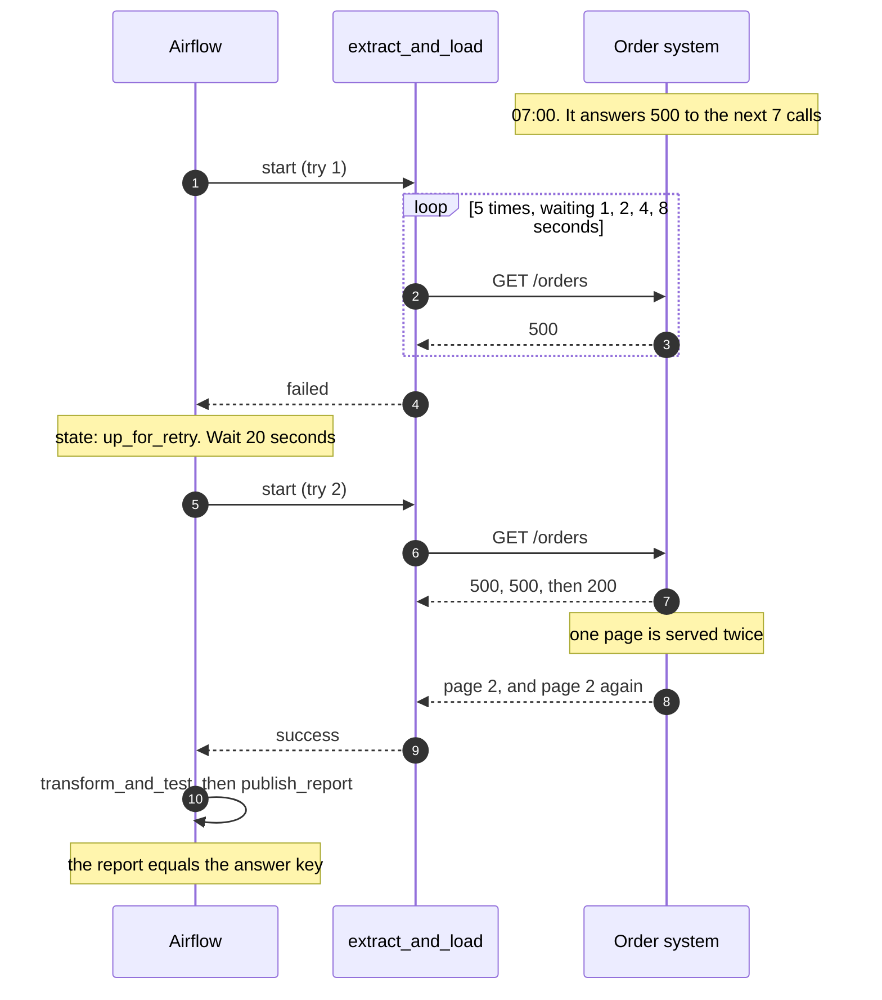

# LLD: Milestone 5, On a schedule

**Status:** Final; built
**Fits inside:** [HLD](HLD.md)

> **What this document is.** A low-level design (LLD) gives the exact detail of each part named in the [HLD](HLD.md). Keep it open beside the notebooks and the code. Section 10 says which notebook and which file build each part.

## 1. Files

Everything is inside `src/m5_on_a_schedule/`, except the two files that describe the containers.

```
docs/                          BRD.md, HLD.md, LLD.md
notebooks/                     the lab: seven notebooks, run in order
dags/
  daily_orders_dag.py          the DAG: four tasks, three arrows
  orders_every_five_minutes_dag.py   the micro-batch lab
daily_orders/                  the pipeline, as steps: extract-load, transform-test, report
dbt_project/                   the same models and table tests as milestone 4
airflow_tools.py               drive Airflow from Python: backfill, replay, trigger, wait
tests/
  test_pipeline.py             the steps, without Airflow
  test_table_tests.py          the table tests fail when they should
  test_dag.py                  the real DAG, on the real Airflow

../../docker-compose.yml       the warehouse, and the "schedule" profile
../../docker/airflow/          the image: Airflow plus the pipeline's own environment
```

## 2. The containers



| Container | Image | What runs in it |
|---|---|---|
| `arden-warehouse` | `postgres:16` | The warehouse, as since milestone 2 |
| `arden-order-system` | `arden-airflow:3.4.0` | The fake order system. In Docker now, so Airflow can reach it |
| `arden-airflow` | `arden-airflow:3.4.0` | `airflow standalone`: the scheduler, the DAG processor and the web page |

The image is the official `apache/airflow:3.4.0` plus one virtual environment, `/opt/arden-venv`, that holds the pipeline's packages. The project folder is mounted at `/opt/arden`, so the container runs the same files you edit.

## 3. The DAG (`dags/daily_orders_dag.py`)

```python
with DAG(
    dag_id="daily_orders",
    schedule=CronDataIntervalTimetable("0 7 * * *", timezone="America/Chicago"),
    start_date=datetime(2026, 6, 1, 12, 0),
    end_date=datetime(2026, 6, 17, 12, 0),
    catchup=False,
    max_active_runs=1,
) as dag:
    ...
    set_source_clock >> extract_and_load >> transform_and_test >> publish_report
```

| Setting | Value | Meaning |
|---|---|---|
| `schedule` | `0 7 * * *` in `America/Chicago`, with data intervals | Every day at 07:00 in Arden. Each run covers the 24 hours before it |
| `start_date`, `end_date` | 1 June to 17 June 2026 | The first and the last business day that gets a run |
| `catchup` | `False` | Missed days are not run by themselves |
| `max_active_runs` | 1 | One run at a time |

The cron line `0 7 * * *` reads: minute 0, hour 7, every day of the month, every month, every day of the week.

| Task | Command | Retries |
|---|---|---|
| `set_source_clock` | `python -m order_system.clock --morning {{ macros.ds_add(ds, 1) }}` | 0 |
| `extract_and_load` | `python -m daily_orders extract-load --run-date {{ macros.ds_add(ds, 1) }}` | 3, 20 seconds apart |
| `transform_and_test` | `python -m daily_orders transform-test` | 0 |
| `publish_report` | `python -m daily_orders report` | 0 |

`{{ ds }}` is the logical date as text, like `2026-06-07`: the business day the run is for. `{{ macros.ds_add(ds, 1) }}` is the day after: the morning the run happens. Airflow fills them in for each run.

`--run-date` is a guard. If the order system's clock is not on that morning, the step stops before it loads anything.

## 4. The steps (`daily_orders/pipeline.py`)

| Step | What it does | Safe to run again because |
|---|---|---|
| `extract-load` | Reads what changed since the watermark minus 2 days. Lands it raw. One transaction | Raw is append-only, and nobody counts from it |
| `transform-test` | `dbt build` for the newest load. Writes down which orders moved an earlier day | The models are rebuilt from raw |
| `report` | Prints the report of the newest run that passed its tests | It only reads |

A step does not hand anything to the next step in memory. `transform-test` reads the newest row of `ops.load_runs` to learn which run it belongs to. So each step can run in its own process, and can be retried alone.

## 5. Commands

All of these run inside the Airflow container. From the project folder, put this in front: `docker compose exec airflow`

| You want to | Command |
|---|---|
| See the DAGs | `airflow dags list` |
| Run one day now, in the terminal, and watch | `airflow dags test daily_orders 2026-06-07T12:00:00+00:00` |
| Start a run for one day | `airflow dags trigger daily_orders --logical-date 2026-06-07T12:00:00+00:00` |
| Run a range of days | `airflow backfill create --dag-id daily_orders --from-date 2026-06-07 --to-date 2026-06-12 --max-active-runs 1` |
| Run a finished day again | `airflow tasks clear daily_orders -s 2026-06-09 -e 2026-06-10 -y` |
| See every run | `airflow dags list-runs daily_orders` |
| See the tasks of one run | `airflow tasks states-for-dag-run daily_orders <run_id>` |

`2026-06-07T12:00:00+00:00` is 07:00 in Arden on 7 June: the logical date of business day 7 June.

A backfill from `2026-06-07` to `2026-06-12` runs the business days 7, 8, 9, 10 and 11 June: `--to-date` is where it stops.

`airflow_tools.py` wraps these commands for the notebooks and the tests: `backfill(first_day, last_day)`, `replay(day)`, `trigger(day)`, `runs()`, `task_states(day)`.

## 6. The states of a task

| State | Meaning |
|---|---|
| `running` | It is working now |
| `success` | It finished |
| `up_for_retry` | It failed, and it has tries left. It will run again after the wait |
| `failed` | It failed, and has no tries left |
| `upstream_failed` | A task before it failed, so it never ran |

## 7. The bad morning drill



Measured in the test `test_the_bad_morning_the_api_is_down_then_a_page_comes_twice`: the task goes `running`, `up_for_retry`, `running`, `success`. The run lands more rows than it has orders, and the report equals the answer key.

Two layers of retry are at work, and they are different:

| Layer | Where | It handles |
|---|---|---|
| In the code (milestone 2) | Inside one call to the API: 5 tries in about 15 seconds | A hiccup of a few seconds |
| In Airflow (this milestone) | The whole task, again, after 20 seconds, up to 3 more times | An outage of a minute or two |

## 8. Checks

| Check | Test |
|---|---|
| A backfill runs a range of days with one command, oldest first | `test_a_backfill_runs_a_range_of_days_with_one_command` |
| The bad morning: the API is down, then a page comes twice | `test_the_bad_morning_the_api_is_down_then_a_page_comes_twice` |
| Replaying a past day changes nothing | `test_replaying_a_past_day_changes_nothing` |
| A failed table test fails the run and skips the report | `test_a_failed_table_test_fails_the_run_and_skips_the_report` |
| A step can be retried without harm | `test_a_step_can_be_retried_without_harm` |
| A run for the wrong morning stops before it loads | `test_a_run_for_the_wrong_morning_stops_before_it_loads` |
| The report equals the answer key on every morning, 2 to 18 June | `test_the_report_equals_the_answer_key_on_every_morning` |

`tests/test_dag.py` drives the real Airflow in Docker. It takes a few minutes, and it resets the lab database `arden_m5`.

## 9. Nothing is still wrong

Every "still wrong" line of this project has been closed.

| It was still wrong that | Closed in |
|---|---|
| It reloads every order every day, and hits the rate limit | Milestone 2: an incremental load |
| A changed order is in the table twice, and a second run makes it worse | Milestone 3: `MERGE`, proved by tests |
| All the logic is in one script, and nothing checks the tables | Milestone 4: models and table tests |
| A person must remember to run it | Milestone 5: a schedule |

A real company would add more. These belong to other projects of the series:

| Next | What it adds |
|---|---|
| **Alerts** | A message to a person when a run fails, and when a run did not happen at all |
| **A quality gate** | Checks with thresholds, findings a person reviews, and a decision to publish or hold |
| **A dashboard** | The report as charts, on top of `marts.daily_orders` |

## 10. Where each part is built

| Notebook | Teaches | Design sections | Code |
|---|---|---|---|
| `01_a_clock_is_not_enough` | Schedule, cron, orchestration | HLD 3 | `pipeline.py` |
| `02_tasks_and_arrows` | DAG, task, dependency | HLD 1; LLD 3 | `dags/daily_orders_dag.py` |
| `03_which_day_is_this_run_for` | Data interval, logical date, trigger | HLD 4, 5; LLD 3, 5 | `dags/daily_orders_dag.py` |
| `04_when_a_task_fails` | Retry, and the states of a task | HLD 6; LLD 6 | |
| `05_the_days_you_missed` | Catchup, backfill, replay | HLD 5; LLD 5 | `airflow_tools.py` |
| `06_every_five_minutes` | Micro-batch, by running it | HLD 8 | `dags/orders_every_five_minutes_dag.py` |
| `07_the_bad_morning` | The drill, and what comes next | LLD 7, 9 | `tests/test_dag.py` |
